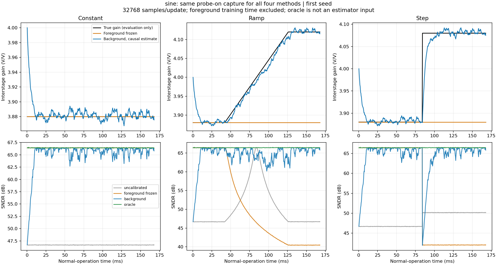

# Dither 后台校准收敛与漂移跟踪实验

日期：2026-10-31。分支：`codex/calibration-expansion`。

已实现一个独立可运行的 Pipeline 首级增益校准仿真：后台根据 PN 与后端码的相关性
更新增益估计，前台对照在独立正弦记录上校准后固定参数。结果显示：固定误差下前台
冻结略优；器件增益漂移或突变后，后台能重新跟踪，而冻结参数明显失效。

## 实现与假设

- [运行脚本](../../python/src/adctoolbox/examples/11_calibration/exp_cal01_dither_background.py)
- [行为模型与估计器](../../python/src/adctoolbox/examples/11_calibration/pipeline_dither_model.py)
- [完整模型说明](../../python/src/adctoolbox/examples/11_calibration/README.md)
- [针对性测试](../../python/tests/unit/test_dither_background_example.py)

模型是七电平粗量化级、名义增益 4、12-bit 理想后端的两级 Pipeline，名义合成
分辨率为 14 bit。输入和后端范围均为 ±1 V。它聚焦级间增益误差，包含输入噪声、
残差噪声、后端量化和过载；尚未包含 DAC 失配、放大器非线性、抖动或模拟记忆。
这不是此前五级 Pipeline 论文模型的完整 Dither 实现，也不是晶体管级仿真。

PN 在粗量化判决之后、残差放大之前注入：

```text
q = coarse_quantize(u)
r = backend_quantize(G * (u - q + a*p) + noise)
y = q + r/G_est - a*p
```

在 PN 独立、注入幅度准确、没有过载，且量化误差与 PN 的相关性足够小时：

```text
G_observed = cov(p, r) / (a * var(p))
G_est_next = (1 - mu) * G_est + mu * G_observed
```

后台仅使用后端输出、PN 符号和后端整数码，不能读取真实输入或真实增益。每个块
先使用旧估计校正，然后更新下一块估计，避免同一批数据拟合后的乐观评估。输入
时间、相位和随机数流跨块连续，不采用历史最佳 SFDR 选择参数。

前台校准关闭 PN，已知正弦频率但不提供真实幅度或相位，联合求解
`q + c*r = A*sin(w*n) + B*cos(w*n) + DC`，随后固定 `G_est = 1/c`。
这是针对子码的专用正弦增益拟合，并非调用 bit 位权函数 `calibrate_weight_sine`。

注入幅度与粗 DAC 标度是已知假设。若注入实际幅度也未知，则相关法识别的是
`G*a`，不能单独辨识两者；该限制有明确单元测试。

## 实验配置

| 项目 | 配置 |
| --- | --- |
| 采样率 | 100 MS/s，行为仿真时间标度 |
| 前台专用采集 | 32 × 32768 点，约 10.49 ms |
| 正常转换阶段 | 512 × 32768 点，约 167.77 ms |
| 后台更新 | 每 32768 点一次，`mu = 0.08` |
| 默认 PN 幅度 | 残差放大前 0.0625 V |
| 输入／残差噪声 RMS | 0.00028 V／0.0002 V |
| 单音 | 峰值 0.85 V，约 0.137 fs，相干频率 |
| 双音 | 峰值分别 0.5 V、0.35 V，约 0.083 fs 和 0.217 fs |
| 初始增益 | 3.88，相对名义值 −3% |
| 固定误差 | 增益始终为 3.88 |
| 缓慢漂移 | 正常阶段中间一半逐样本线性变化，3.88 → 4.12 |
| 突变 | 正常阶段中点从 3.88 变为 4.08 |
| 随机种子 | 11、22、33 |

共 3 种场景 × 2 种输入 × 3 个种子，即 18 组主实验。漂移速度用于压力测试，
不是实测温度漂移模型。前台校准时间未计入图中正常转换阶段，但单独列明。

## 单音结果

主对比的未校准、前台冻结、后台和理想增益对照使用完全相同的带 PN 捕获。
另有关闭 PN 的反事实对照，使用同一输入与相同模拟噪声实现，避免注入本身影响
冻结模型表现而被遗漏。下表是各运行最后四分之一的逐块 SNDR 平均，再对三个种子平均。

| 场景 | 未校准，PN 开 | 前台冻结，PN 开 | 前台冻结，PN 关 | 后台，PN 开 | 理想增益，PN 开 |
| --- | ---: | ---: | ---: | ---: | ---: |
| 固定误差 | 46.67 | 66.42 | 66.42 | 65.77 | 66.42 |
| 漂移结束后 | 46.69 | 40.46 | 43.11 | 65.65 | 66.44 |
| 突变并恢复后 | 50.16 | 42.03 | 44.68 | 65.79 | 66.44 |

单位均为 dB。理想增益仅是评估上界，不进入估计器。

漂移仍在发生的中间区间，后台平均 **63.91 dB**，前台冻结且关闭 PN 为 **50.89 dB**，
说明收益不只存在于漂移结束后的稳态。突变之后第一个四分之一区间包含恢复过程，
后台平均 **62.41 dB**，对应冻结且关闭 PN 为 **44.68 dB**。

在固定误差下，后台约比前台低 0.65 dB。有限长度 PN 相关估计会波动，持续跟踪
并不保证在不变器件上优于一次较准确的前台辨识。漂移后即使让冻结对照关闭 PN，
后台仍然有明确收益。



图展示种子 11 的完整轨迹；上表使用三个种子。后台波动及突变瞬间的退化均保留，
没有选择历史最好参数，也没有平滑掉瞬态。

## 收敛与恢复

诊断标准预先设为：第一个已完成的 16 块窗口中，相对增益误差 RMS 低于 0.2%。
该标准读取真实增益仅用于报告，不控制学习停止，也不保证后续每个窗口都低于阈值。

| 单音种子 | 启动收敛，ms | 突变恢复，ms |
| --- | ---: | ---: |
| 11 | 13.43 | 20.32 |
| 22 | 13.43 | 14.09 |
| 33 | 14.75 | 17.69 |

18 组默认实验均无输入／后端过载，没有冻结更新；逐块检查确认当前使用的增益
总是上一块更新后的增益。

## 双音验证与注入幅度检查

双音后台不使用单音拟合或已知输入频率。双音指标是“期望双音总功率／噪声与失真”，
不能直接与单音 SNDR 作等幅比较。

| 双音场景，最后四分之一 | 前台冻结，PN 关 | 后台，PN 开 | 理想增益，PN 开 |
| --- | ---: | ---: | ---: |
| 固定误差 | 63.54 | 62.92 | 63.54 |
| 漂移结束后 | 39.71 | 62.85 | 63.56 |
| 突变并恢复后 | 41.29 | 62.94 | 63.56 |

双音正在漂移区间，后台为 61.26 dB，冻结且关闭 PN 为 47.55 dB。

另外以单音、固定误差、种子 11 做了两组幅度诊断，其他主要配置不变：

| PN 幅度，V | 后台最终 SNDR，dB | 更新状态 |
| --- | ---: | --- |
| 0.015625 | 63.60 | 正常，弱探针使相关估计方差增大 |
| 0.0625 | 65.85 | 默认配置，无过载 |
| 0.1875 | 30.73 | 后端过载，512 次更新全部冻结 |

过载保护通过可观测的后端码触轨判断，冻结整个块；不选择性保留未裁剪样本，以免
改变 PN 条件统计。保护防止错误学习，但不修复已经裁剪的信号。该幅度检查是追加
诊断，并非用于从测试集选择默认参数。

## 验证与复现

- 新增 15 项测试全部通过，覆盖物理注入、量化误差界、随机流分块一致性、相关
  辨识、激励不足／触轨冻结、前台拟合、因果更新、突变跟踪和输出文件。
- 单音 FFT 指标与工具箱 `analyze_spectrum` 对照通过。
- 技能安装与用户指南示例检查：16 项通过、1 项跳过；两条既有单次正弦拟合未收敛警告。
- 从构建的 wheel 提取示例后，独立命令行运行通过；wheel 包含辅助代码和 README，
  不包含实验输出与字节码缓存。技能安装测试只使用临时目标目录。

在仓库根目录运行：

```powershell
.\python\.venv\Scripts\python.exe python/src/adctoolbox/examples/11_calibration/exp_cal01_dither_background.py --output python/src/adctoolbox/examples/11_calibration/output/dither_background_20261031
```

默认命令重复已有相同配置会重跑；修改配置或源码后应选新的输出目录。主输出包含
逐块 CSV、每组总结、汇总表、图片、参数以及两个模型源文件的 SHA-256。
版本化的[汇总 CSV](dither-background-20261031.csv)保留每个区间的均值和跨种子标准差。
完整逐块结果留在上述被 Git 忽略的输出目录，并另行归档。

## 后续边界

本次完成首批范围中的 Dither 后台增益校准仿真。前台多项式／神经网络正式案例仍待
整理。后续可增加 PN 幅度误差、DAC 失配、非线性、记忆、输入突变和不同更新带宽，
但需要相应的可观测性与误差方程，不能把本例的单增益估计直接称为通用校准。
