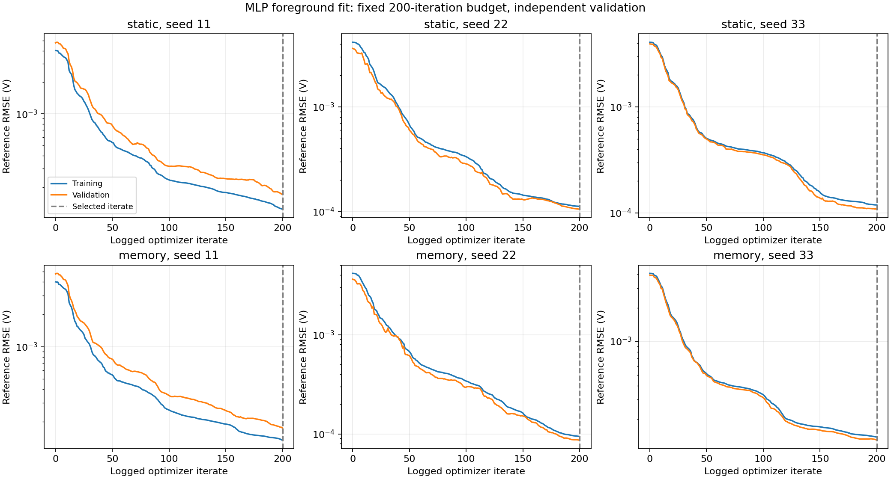
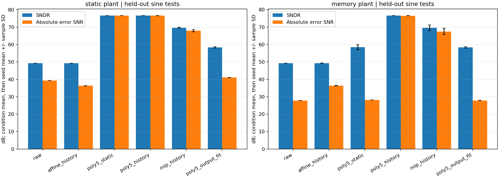
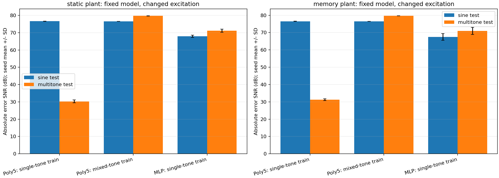
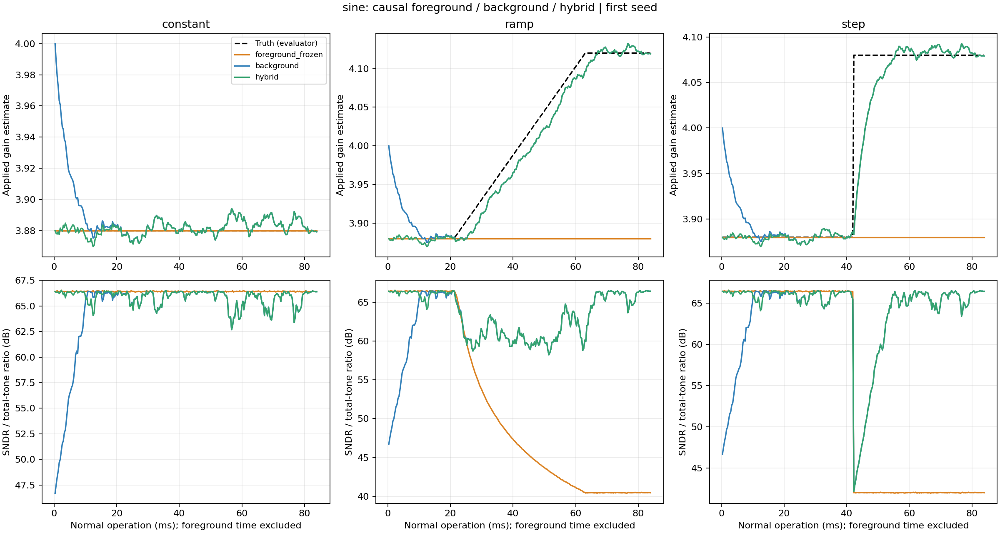

# ADCToolbox 校准体系实现与验收报告

- 日期：2026-11-01；分支：`codex/calibration-expansion`。
- 范围：前台多项式／轻量 MLP、公共 Pipeline 增益辨识与校正、前台初始化＋后台跟踪。
- 状态：代码、正式示例、多种子实验、保存模型重放、分发验证已完成。

## 本次交付

新增公共接口（同时从 `adctoolbox` 和 `adctoolbox.calibration` 导出）：

| 接口 | 作用 |
| --- | --- |
| `build_calibration_features` | 当前／历史输入构造、标签索引、跨块状态 |
| `fit_calibration_polynomial` | 含交叉项的直接多项式校正、秩与拟合诊断 |
| `fit_calibration_mlp` | 固定线性基线＋可训练 tanh MLP，独立验证选择迭代 |
| `apply_calibration` | JSON 模型冻结应用、输入范围提示 |
| `fit_pipeline_gain_sine` | 专用正弦、内部子码观测、流式 QR 增益拟合 |
| `DitherGainTracker` | apply/update/reset、PN 相关辨识、保护及前台初始化 |
| `apply_gain_calibration` | 前后台共享的冻结增益校正与已知 PN 消除 |

新示例为 `exp_cal03_foreground_nonlinear.py`、`exp_cal04_hybrid_tracking.py`、
`exp_cal05_foreground_excitation.py`；
独立审计入口为 `audit_calibration_acceptance.py`。
旧 Dither 示例保留调用名称，增益类／拟合转向公共模块；其余记忆、电容和非线性
后台机制保留为专门示例，不声称已经成为通用后台接口。

完整接口约定见
[FOREGROUND_AND_HYBRID.md](../../python/src/adctoolbox/examples/11_calibration/FOREGROUND_AND_HYBRID.md)，
体系导航见 [CALIBRATION_SYSTEM.md](../../python/src/adctoolbox/examples/11_calibration/CALIBRATION_SYSTEM.md)。

## 前台实验：数据、模型和训练

两种行为器件：`u=0.99x+0.015x²+0.04x³`；第二种再叠加 `0.04u[n-1]`。
输出为 [-1,1] 的 14-bit 量化，量化前噪声 RMS 10 μV。它是非线性前端模型，
不是原五级 Pipeline 论文模型，也不是晶体管级仿真。所有方法只访问最终码值及
至多三拍历史，不读取内部无噪声节点。

每种器件、每个种子（11、22、33）：

- 400 条训练记录 ×8192 点，共 3,276,800 点；固定 stride=16，实际拟合 204,800 行。
- 40 条独立验证记录 ×8192 点；验证选择使用 20,480 行。
- 20 个测试条件，每个完整评估 8192 点；训练、验证、测试的单音频率 bin 不重合。
- 标签来自独立 16-bit 参考监测通道（200 μV RMS 噪声）的已知频率正弦拟合；
  幅度、相位、DC 均由观测数据求解，不把模拟真值当训练标签。
- 另设输出自身正弦拟合作标签的对照；测试真值只进入评估器。

多项式用训练数据归一化、均方误差＋ridge=1e-10；阶数分别报告，不按测试结果挑选。
MLP 输入四列、隐藏层 16 个 tanh 单元，学习线性基线的残差，L2=1e-6，L-BFGS 预算 200 次。
其线性基线参数和网络参数合计 102 个；五阶四输入多项式为 126 个系数，
五阶静态多项式为 6 个系数。归一化统计量另存，不包含在上述系数计数中。
六次 MLP 拟合均达到迭代上限，不能解释为找到全局最优或优化器已收敛。



## 前台结果

下表单位 dB；先在 15 个单音条件内求均值，再报告三个种子的均值±样本标准差。
幅度为 0.1/0.5/0.85，频率约为 0.031/0.113/0.239/0.371/0.467 fs。
其中 0.467 fs 超出训练频率上限约 0.45 fs，属于频率外推测试。
“绝对误差 SNR”直接比较输出与真值，不做幅度、相位或 DC 对齐。

| 方法 | 静态：SNDR | 静态：绝对误差 SNR | 带记忆：SNDR | 带记忆：绝对误差 SNR |
| --- | --- | --- | --- | --- |
| 未校准 | 49.33 ± 0.01 | 39.29 ± 0.00 | 49.29 ± 0.01 | 27.79 ± 0.00 |
| 线性＋历史 | 49.33 ± 0.01 | 36.35 ± 0.08 | 49.32 ± 0.01 | 36.35 ± 0.08 |
| 三阶静态多项式 | 68.44 ± 0.00 | 65.45 ± 0.04 | 61.74 ± 3.08 | 28.13 ± 0.02 |
| 五阶静态多项式 | 76.61 ± 0.01 | 76.59 ± 0.01 | 58.47 ± 1.46 | 28.18 ± 0.04 |
| 三阶多项式＋历史 | 68.42 ± 0.04 | 65.83 ± 0.05 | 68.42 ± 0.04 | 65.82 ± 0.06 |
| 五阶多项式＋历史 | 76.63 ± 0.02 | 76.60 ± 0.02 | 76.59 ± 0.01 | 76.53 ± 0.01 |
| MLP＋历史 | 69.66 ± 0.20 | 67.94 ± 0.64 | 69.56 ± 1.66 | 67.47 ± 1.91 |
| 五阶＋历史，输出拟合标签 | 58.35 ± 0.35 | 41.06 ± 0.05 | 58.34 ± 0.35 | 27.86 ± 0.03 |




多音、扫频和失配压力测试单独列出：

| 测试组 | 器件 | 五阶＋历史：误差 SNR | MLP＋历史：误差 SNR |
| --- | --- | --- | --- |
| multitone | static | 30.27 ± 0.82 | 71.15 ± 0.94 |
| multitone | memory | 31.24 ± 0.53 | 70.96 ± 2.03 |
| chirp | static | 82.66 ± 0.18 | 71.26 ± 0.67 |
| chirp | memory | 82.93 ± 0.16 | 71.07 ± 2.02 |
| drift_stress | static | 30.72 ± 0.00 | 30.65 ± 0.02 |
| drift_stress | memory | 30.72 ± 0.00 | 30.66 ± 0.02 |
| overload_stress | static | 44.45 ± 0.11 | 47.03 ± 0.34 |
| overload_stress | memory | 34.77 ± 0.07 | 36.16 ± 0.06 |


`drift_stress` 把器件增益提高 2%、三阶系数提高 50%，继续使用冻结模型；
`overload_stress` 使用幅度 0.98，可能发生削顶，不能视为普通域内性能。
多音是双音／三音；扫频只报告时域误差，不把它当单音 SNDR。

结论：在单音测试中，多项式表现较好；但单音训练的五阶历史多项式在多音测试中
明显失效，绝对误差 SNR 只有约 30 dB，MLP 则约为 71 dB。不能用单音平均结果
宣称多项式普遍优于 MLP。数值满秩和边际输入范围覆盖，也不足以保证多变量历史
特征的联合激励充分。为分离模型结构和训练覆盖问题，另做同预算混合激励对照。
静态校正能改善带记忆器件的频谱，却不能消除全部时间／相位误差；历史输入和
绝对误差指标有必要保留。失真输出的正弦拟合只提供一个近似参考，不能凭空恢复
绝对增益、相位和跨波形一致的理想标签。独立监测通道的准确性也是本实验的明确假设。

## 固定模型、改变训练激励的补充对照

保留每组 400×8192 点采集、stride=16、同样的多项式阶数与 ridge；把一半训练
记录换成双音，单条记录的总峰值幅度预算仍为 [0.05,0.90]。双音频率排除原验证／
测试 tone bin。六组控制均使用原有全部测试条件和捕获种子；没有按测试结果选择
阶数或正则化。MLP 在这个控制中没有重新训练，表中明确保留原单音训练结果。

下表为绝对误差 SNR，dB：

| 器件 | 测试 | 五阶历史：单音训练 | 五阶历史：混合训练 | MLP：原单音训练 |
| --- | --- | --- | --- | --- |
| static | sine | 76.60 ± 0.02 | 76.53 ± 0.04 | 67.94 ± 0.64 |
| static | multitone | 30.27 ± 0.82 | 79.70 ± 0.04 | 71.15 ± 0.94 |
| memory | sine | 76.53 ± 0.01 | 76.50 ± 0.00 | 67.47 ± 1.91 |
| memory | multitone | 31.24 ± 0.53 | 79.67 ± 0.01 | 70.96 ± 2.03 |




只改变激励类型，就恢复了历史多项式的多音性能，同时保持单音性能。这支持把
联合特征覆盖作为训练协议的一部分，而不是只增加同类单音记录。
理想零 DC 单音的四个连续样本满足
`x0*x2 + x2² - x1² - x1*x3 = 0`：由两个二阶正弦递推式交叉相乘即可得到。
失真和噪声会扰动这个关系，使矩阵可能数值满秩，但不代表所有历史交叉特征都
得到充分独立激励。观察到的失效与这一机制一致。
这组控制不构成“混合训练多项式优于混合训练 MLP”的证据，因为后者未运行。

## 后台与混合流程

仍使用原两级 Pipeline 增益模型和相同噪声、量化、PN 注入设置。
前台通过专用正弦的 16×32768 点拟合初值，耗时 5.243 ms（100 MS/s）。
正常工作为 256×32768 点，83.886 ms；两种波形×三种漂移场景×三个种子，共 18 组。
后台初值为标称增益 4，混合流程初值为前台估计；其余更新参数与输入捕获完全相同。
每块先用旧参数校正，再由该块观测更新下一块参数。真实增益只用于器件和评估。

单音结果，单位 dB，三个种子的均值±样本标准差：

| 场景／窗口 | 前台冻结（注入开） | 后台，标称初始化 | 前台初始化＋后台 | 前台冻结（注入关） |
| --- | --- | --- | --- | --- |
| constant / first_16_blocks | 66.42 ± 0.01 | 51.47 ± 0.51 | 65.91 ± 0.68 | 66.42 ± 0.01 |
| constant / final_quarter | 66.42 ± 0.00 | 65.77 ± 0.22 | 65.77 ± 0.22 | 66.42 ± 0.00 |
| ramp / active_ramp | 48.47 ± 0.01 | 60.82 ± 0.15 | 60.81 ± 0.15 | 50.89 ± 0.01 |
| step / final_quarter | 42.03 ± 0.00 | 65.80 ± 0.21 | 65.80 ± 0.21 | 44.68 ± 0.00 |




混合流程减少了启动失配，但初始前台采集时间必须计入；它不会消除后续相关估计
噪声或跟踪滞后。经过充分更新，两种后台初值的差异衰减。静态器件下，冻结前台
参数可能更好；漂移或突变后，持续更新恢复性能。跟踪曲线展示当前参数，未使用
历史最佳 SFDR 选点。过载计数均为零。

## 验证与验收入口

- 校准单元／旧 Dither 机制／技能安装和示例：123 项通过；1 项因 Windows 符号链接
  权限跳过，1 项为原有 Nyquist 频率估计预期失败，6 项 slow 测试按默认配置排除。
- 独立审计通过：6 组前台结果，重放
  1080 条方法／条件记录；最大指标差
  0 dB。训练／验证／测试分离和汇总重算通过。
- 后台 18 组、4608 个数据块的
  初始化、参数前后衔接与汇总重算通过。原始轨迹与已执行源码快照均保留。
- 激励控制 6 组、
  480 条新增冻结模型测试记录重放与汇总重算通过。
- 干净 sdist→wheel 构建；从 wheel 解压后导入 API、复制示例、运行两套小型实验与
  重放审计通过。真实技能目录未改动，临时目录安装显示 synced。
- 新文档无新增诊断；全量 Sphinx 仍有原有 `analyze_error_spectrum` docstring 缩进诊断。

从 `python/` 目录复跑本次规模（使用新的输出目录）：

```bash
uv run python src/adctoolbox/examples/11_calibration/exp_cal03_foreground_nonlinear.py --records 400 --validation-records 40 --output output/foreground_acceptance
uv run python src/adctoolbox/examples/11_calibration/exp_cal04_hybrid_tracking.py --output output/hybrid_acceptance
uv run python src/adctoolbox/examples/11_calibration/exp_cal05_foreground_excitation.py --baseline output/foreground_acceptance --output output/excitation_acceptance
uv run python src/adctoolbox/examples/11_calibration/audit_calibration_acceptance.py --foreground output/foreground_acceptance --hybrid output/hybrid_acceptance --excitation output/excitation_acceptance --output output/calibration_audit.json
```

训练和推断均只依赖 NumPy/SciPy，不需要 GPU 或 PyTorch。所有输出目录非空保护，
不会自动覆盖已有实验。当前源码、模型、配置、记录、图表和本报告另有 zip 验收归档。

版本管理内的精简证据：

- [前台汇总](calibration-foreground-20261101.csv)
- [前台逐条件结果](calibration-foreground-tests-20261101.csv)
- [后台／混合汇总](calibration-hybrid-20261101.csv)
- [激励覆盖对照](calibration-excitation-20261101.csv)
- [完整审计结果](calibration-acceptance-20261101-audit.json)

本地完整结果目录：

- `python/src/adctoolbox/examples/11_calibration/output/foreground_acceptance_20261101/`
- `python/src/adctoolbox/examples/11_calibration/output/hybrid_acceptance_final_20261101/`
- `python/src/adctoolbox/examples/11_calibration/output/excitation_acceptance_20261101/`

这些实验支持本次行为模型和所列测试条件。三个随机种子衡量的是采集噪声和训练
初始化变化，不是三个独立工艺角。通用 LUT、TI 后台连续流完善、SAR 后台及多级
联合非线性记忆跟踪仍不在本次已实现范围内。
