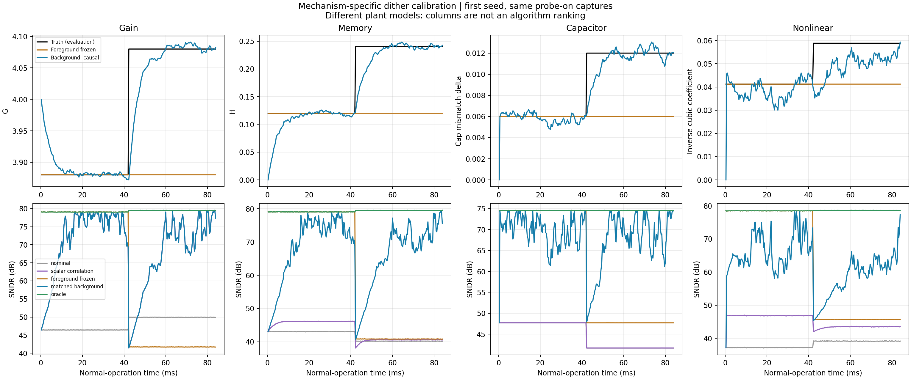
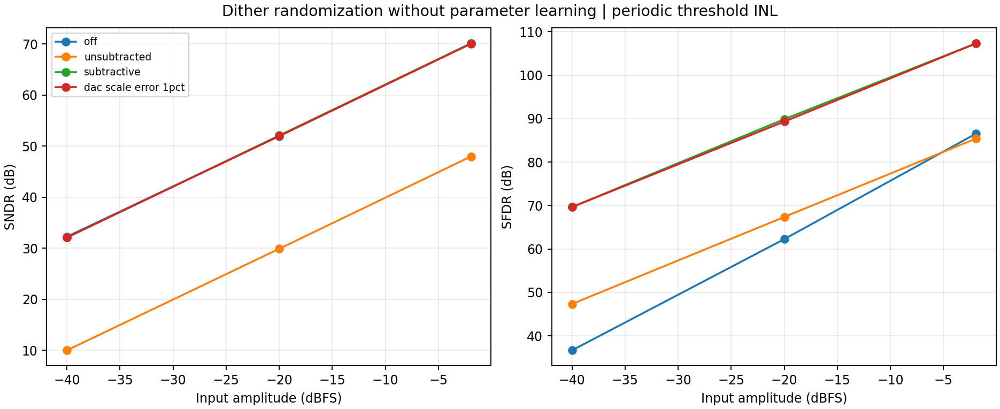

# Dither 的工程用法、原始资料与机制覆盖实验

日期：2026-11-01。分支：`codex/calibration-expansion`。

## 结论与分类

Dither 辅助校准是已有多年芯片应用的成熟方法族，不应把它缩减成一个增益相关公式。
但是厂商称为 dither 的功能不一定包含在线参数辨识，需要分清下面三类。

| 类别 | 常见做法 | 目标与限制 |
| --- | --- | --- |
| 线性化／随机化 dither | 模拟端加扰动；数字端减去已知分量，或用数字滤波去除带外扰动 | 降低码相关误差的离散杂散；可能只是把失真变成噪声，SNDR 未必提高 |
| 校准 dither | PN 注入特定节点，与数字化余量相关；低通／累加得到误差参数 | 需要注入路径与待辨识参数对应，参数用于实际校正 |
| 随机切换辅助辨识 | 电容角色交换、DEM 元件选择，将失配调制到已知序列上，再相关与抵消 | 不一定是额外叠加电压；属于相近的随机调制／相关辨识方法族 |

工业实现可以组合这些方法。例如 DAC noise cancellation 和 gain error correction
可以分别运行；calibration dither 和 linearization dither 也可以同时存在。
不能把“有 dither”直接解释为“所有失真都由一个相关系数校正”。

## 官方及原始资料

资料访问日期与出版日期分开记录；下列内容为阅读后的概述，不是厂家内部实现的逆向推断。

| 来源与链接 | 阅读位置／证据 | 对工具包的启示 |
| --- | --- | --- |
| [ADI：Internal Dither Improves High Speed ADC SFDR Performance，2014](https://www.analog.com/en/resources/technical-articles/internal-dither-improves-high-speed-adc-sfdr-performance.html) | LTC2208 的长伪随机序列、模拟 dither DAC、数字减法；强调 DAC 校准与残留噪声 | 单列减法 dither 实验，不能把它当成在线误差估计的证明 |
| [ADI AN-835：Dither Testing](https://www.analog.com/en/resources/app-notes/an-835.html) | 区分带外和宽带扰动，讨论局部静态误差与 slew-rate 失真的不同响应 | 同时看 SFDR、总噪声失真和输入余量 |
| [TI SLAA617，2013，section 3.4](https://www.ti.com/lit/pdf/SLAA617) | 实测例子中部分谐波改善，部分不变；输入 dither 不能解决其例子中的交织杂散 | 保留失败对照，避免“所有谐波都能消除”的承诺 |
| [TI ADC32RF52 数据手册，2023，section 7.3.1.4](https://www.ti.com/lit/gpn/ADC32RF52) | 带外 dither 的幅度、频带、分频设置及邻近杂散，包含输入余量约束 | 序列周期、频带与更新速率属于工程参数，不是越随机越好 |
| [ADI AD9208 数据手册，Dither 小节](https://www.analog.com/media/en/technical-documentation/data-sheets/AD9208.pdf) | 片上减法 dither 默认开启，规格在开启状态获得 | 比较数据手册性能时必须记录 dither 状态；不从该小节推断专有后台算法 |
| [Siragusa & Galton，JSSC 2004](https://ispg.ucsd.edu/uploads/2017/05/2004-JSSC-E.-Siragusa-A-Digitally-Enhanced-1.8-V-15-bit-40-MSampleps-CMOS-Pipelined-ADC.pdf) | pp. 2129–2132 的 DEM/DNC 与 GEC；实测芯片使用多路切换序列相关和独立的级间增益相关 | 是成熟硬件应用的直接证据；失配与增益采用不同观测关系 |
| [Sun, Lee & Ham，TCAS-II 2008](https://people.seas.harvard.edu/~donhee/SLH_TCAS2.pdf) | Fig. 4、式 (9)–(13)，以及 1.5-bit／多 bit stage 的加权函数 | 电容切换使失配可见；简单相关可能因对称性抵消，需要合适的码相关权重 |
| [Keane, Hurst & Lewis，TCAS-I 2006](https://doi.org/10.1109/TCSI.2005.858760) | [作者目录](https://www.ece.ucdavis.edu/~hurst/papers/)与公开摘要确认后台记忆校准；作者全文链接本次返回 403 | 记忆后台校准不是新设想；本轮两抽头模型并非其两种算法的复现 |
| [Ali et al.，VLSI Circuits 2016](https://doi.org/10.1109/VLSIC.2016.7573537) | 出版商摘要列出级间增益、建立、kick-back 和记忆的相关式后台校准 | 商业厂商的高速 ADC 已使用多种相关校准；本次未取得其完整内部实现 |
| [He et al.，ELEX 2025](https://www.jstage.jst.go.jp/article/elex/22/5/22_22.20240726/_article) | 全文 Fig. 1–3 区分 calibration 与 linearization dither；同时改变 sub-ADC 和 MDAC 以处理余量；Fig. 9–10 是芯片测量 | 本轮增益注入是简化路径，不能代表完整 dual-dither 电路 |
| [Parallel correlation estimation，Microelectronics Journal 2026](https://doi.org/10.1016/j.mejo.2025.107044) | 出版商摘要／预览说明两个不对称扰动区间用于非线性增益辨识；全文访问受限 | 非线性需要多个独立观测；本轮采用自推导的逆多项式矩方法，不冒充该论文实现 |
| [MathWorks：Time-Domain Correlation Analysis](https://www.mathworks.com/help/ident/ug/what-is-time-domain-correlation-analysis.html) | 输入输出相关用于线性动态系统冲激响应估计 | 多延迟相关是标准辨识工具；与 ADC 注入点相结合后仍需具体建模 |

补充：[Li et al.，Correlation Techniques for Estimation of Amplifier Nonlinearity，2004](https://ispg.ucsd.edu/uploads/2017/05/2004-RWC-M.-Li-Correlation-Techniques-for-Estimation-of-Amplifier-Nonlinearity.pdf)
讨论构造高阶测试序列以提取非线性，并分析有限序列的相关误差。这是 PA 工作，不把它
列为 ADC 芯片复现依据。

## 工程上通常如何做

这些资料共同支持以下设计流程，而不是单纯“加随机噪声”。

1. **选择误差进入的路径。** 注入信号必须经历待估计的增益／动态路径；失配可以通过
   元件切换调制出来。数字输出之后再加随机数不能代替模拟路径中的激励。
2. **利用冗余并管理余量。** 简单加法注入可能使后端过载；窗口注入、阈值与 MDAC 配合、
   互补注入等是不同电路方案。不能把我们的整块 rail 拒绝策略等同于这些电路。
3. **设计序列与观测量。** 长 PN、多个序列、多个延迟或码字／幅度窗口各有用途。
   注入序列必须与观测数据正确对齐。若采用信号相关注入，必须重新推导相应统计关系。
4. **平均和慢速更新。** 业务信号对估计器通常是干扰；步长、累加长度和漂移速度形成折中。
   增大 dither 可提高辨识信噪比，但会消耗余量或加重非线性。
5. **数字校正与扰动消除。** 去除已知注入量仍依赖模拟／数字尺度匹配；偏差会产生残留。
   非线性和记忆路径需要对应的逆映射／滤波器，不只是一个增益乘法。
6. **按业务条件验收。** 记录输入幅度、频率、带宽、波形、dither 状态和测量带宽；同时
   观察 SFDR、SNDR、收敛时间、跟踪和过载。SFDR 的提高不自动代表总误差降低。

以上是公开资料归纳。没有把仿真结果写成实测经验，也没有推断商业芯片未公开的算法。

## 本次实验的实现

代码入口：[`exp_cal02_dither_coverage.py`](../../python/src/adctoolbox/examples/11_calibration/exp_cal02_dither_coverage.py)。
完整模型方程、参考关系、假设和命令见
[`DITHER_COVERAGE.md`](../../python/src/adctoolbox/examples/11_calibration/DITHER_COVERAGE.md)。

| 实验 | 模型与可观测量 | 比较内容 |
| --- | --- | --- |
| 减法 dither | 单调、周期阈值 INL 的 14-bit 量化器，模拟注入后量化再数字相减 | off、不减扰动、正确相减、模拟幅度多 1%；另加注入点之前的三阶失真 |
| 级间增益 | 七电平粗级＋12-bit 后端，真实 LFSR PN；只用后端码和 PN | 原有单相关法、前台冻结、后台跟踪、理想参数对照 |
| 一阶记忆 | `r[n]=G*v[n]+H*v[n-1]`，包含连续模拟和校正器状态 | 零延迟相关与两延迟相关，求逆滤波后消除扰动 |
| 电容失配 | 两个实际归一化电容随机交换采样／反馈角色，1.5-bit 粗级＋13-bit 后端 | 普通 PN 相关与子码加权相关；精确电容比模型与单参数逆校正 |
| 非线性 | 单调压缩放大器，逆映射为三阶多项式；四电平 PN | 单相关有效增益与两个独立相关条件；二值 PN 秩亏对照 |

后两项是文献原理启发的独立简化实现，不是逐电路／逐系数复现论文。电容实验没有额外
叠加电压，而是随机调制电容角色；其分类在图表与说明中明确保留。

主实验 48 组：4 类校准机制 × 单音／双音 × 固定／突变 × 3 个种子。每组正常转换
8,388,608 点，前台专用正弦采集 524,288 点。单音峰值 0.8，双音峰值 0.46＋0.34；
频率、后端位数和噪声均在配置与模型说明中列出。测试参数在中点发生阶跃，前台参数冻结。

每组比较同一份 probe-on 数据下的名义参数、简单相关、前台冻结、匹配机制的后台和
真实参数诊断。另有相同噪声的 probe-off 对照；电容项 probe-off 指固定电容角色。
真实输入不进入后台估计器，理想参数只用于仿真器和评估器；当前块先校正，更新参数用于下一块。

本轮没有加入输入采样噪声和 jitter，只有后端输入噪声 RMS 0.0002 与量化。因此不能将
本轮约 75–80 dB 的理想参数结果与上轮约 66 dB 的噪声配置直接比较。

减法 dither 另有 72 个测量结果，覆盖 18 个 seed／幅度／上游非线性组合中的四种模式。
这些均不是后台参数训练。

## 实验结果

以下为最后四分之一数据窗口、三个 PN／噪声种子的均值。种子未改变器件误差参数，
因此不是器件 Monte Carlo。表内比较同一 probe-on 捕获；各行是不同器件模型，不能横向排名。

**单音：参数突变后，SNDR（dB）**

| 机制 | 名义参数 | 简单相关 | 前台冻结 | 匹配机制的后台（均值 ± SD） | 理想参数 |
| --- | ---: | ---: | ---: | ---: | ---: |
| 级间增益 | 49.93 | 75.63 | 41.72 | 75.63 ± 1.28 | 79.49 |
| 增益＋一阶记忆 | 40.17 | 40.56 | 40.82 | 72.73 ± 0.63 | 79.48 |
| 电容失配 | 41.70 | 41.70 | 47.71 | 70.08 ± 0.41 | 74.54 |
| 增益＋非线性 | 39.15 | 43.53 | 45.73 | 64.93 ± 2.15 | 78.61 |

电容项的“简单相关”因统计关系退化而保持名义参数，不是后台成功收敛到该性能。
增益项的简单相关就是匹配模型的方法，两列相同是预期行为。

**静态器件与 probe-off 对照：单音 SNDR（dB）**

| 机制 | 静态：前台冻结／probe-on | 静态：持续后台 | 突变后：前台冻结／probe-off | 突变后：持续后台／probe-on |
| --- | ---: | ---: | ---: | ---: |
| 级间增益 | 79.06 | 75.28 | 44.57 | 75.63 |
| 增益＋一阶记忆 | 79.05 | 72.53 | 44.00 | 72.73 |
| 电容失配 | 74.54 | 70.08 | 51.12 | 70.08 |
| 增益＋非线性 | 78.49 | 65.05 | 46.59 | 64.93 |

静态器件下，本模型中充分训练的前台参数更安静；后台需要用稳态估计波动换取持续跟踪能力。
这不是前台与后台谁普遍更优。

**双音：突变后的总期望信号／噪声失真比（dB）**

| 机制 | 简单相关 | 前台冻结 | 匹配机制的后台 | 理想参数 |
| --- | ---: | ---: | ---: | ---: |
| 级间增益 | 70.76 | 38.27 | 70.76 | 76.58 |
| 增益＋一阶记忆 | 37.12 | 36.95 | 68.52 | 76.57 |
| 电容失配 | 38.44 | 44.46 | 67.46 | 71.63 |
| 增益＋非线性 | 39.99 | 42.85 | 62.19 | 75.61 |

**减法 dither：小信号（峰值 0.01，−40 dBFS）、仅周期阈值 INL**

| 模式 | SNDR（dB） | SFDR（dB） |
| --- | ---: | ---: |
| off | 32.24 | 36.66 |
| unsubtracted | 9.98 | 47.33 |
| subtractive | 32.06 | 69.64 |
| dac_scale_error_1pct | 32.10 | 69.63 |

减法 dither 大幅降低最大杂散，但积分 SNDR 基本没有提高。1% DAC 尺度误差在本例中
被较大的 INL 随机化噪声掩盖，不能据此认定 DAC 匹配不重要。
在峰值 0.8、注入点之前带三阶失真的案例中，dither on/off 的 SFDR 都约为 46.5 dB；
本模型中的下游 dither 无法消除上游失真。





完整均值、标准差和瞬态窗口：[校准聚合 CSV](dither-coverage-20261101.csv)；
全部随机化测量：[线性化 CSV](dither-linearization-20261101.csv)。

**结果的实际边界：** 非线性后台仍落后理想参数约十余 dB，且种子波动明显；
两个高阶相关条件虽能辨识参数，但有限数据下的精度和跟踪折中尚未优化。
本轮证明机制可行，不宣称达到成熟商业算法的性能。

## 可辨识性与失效对照

单独保存 `diagnostics.json`，不把失败案例混入主表平均。

- 正确对齐时可估计响应；参考序列错一拍，零延迟结果接近零。
- 实际注入幅度 0.070、算法假设 0.0625，估计的增益产生相应比例偏差。
- 人为让输入包含与 PN 相同的分量，相关估计有偏；这不是普通随机输入测试，而是故意
  破坏独立性假设的反例。短周期锁定对照同样属于刻意构造的输入。
- 非线性例中二值 PN 使两个选定的奇次统计量线性相关；估计器报告秩亏并保持参数。
  这不意味着所有二值 PN 非线性算法都不可行，窗口与其他观测可以补充信息。
- 电容例仅访问中间子码时，所选加权统计量没有激励，算法保持参数。
- 大扰动导致后端过载时，根据可观测 rail 码冻结更新。冻结保护不能恢复已被截断的数据。

## 范围与下一步

本次覆盖五种代表性机制及其对照，不声称穷举 dither 算法。未完成的部分包括：

- 完整多级 Pipeline 的联合辨识、级间耦合，以及非理想后端对相关精度的影响；
- 实际多单元 DAC 的 DEM/DNC 与 SAR 冗余后台算法；
- 非线性记忆、参考动态误差、jitter、metastability；
- 完整 dual-dither／窗口注入电路与固定点、硬件成本；
- 带外非减法 dither 的完整滤波链实验；
- 非线性逆模型不匹配、多档业务幅度切换和更广器件 Monte Carlo。

当前结果支持将 dither 组织成“序列／注入或切换模型—观测统计量—自适应参数—校正器”
几部分。成熟方法的共性是这个闭环；具体观测与校正必须保留与误差机制的对应关系。
连续增益漂移和幅度扫描已在[前一轮实验](2026-10-31-dither-background.md)中完成；
本轮主要扩展误差机制，不能用突变实验代称全部 PVT 跟踪验证。

## 复现与验证

从仓库根目录运行：

```powershell
.\python\.venv\Scripts\python.exe python/src/adctoolbox/examples/11_calibration/exp_cal02_dither_coverage.py --output python/src/adctoolbox/examples/11_calibration/output/dither_coverage_20261101
```

已有输出时需换新目录，脚本不会覆盖不同实验。原始输出在 `examples/11_calibration/output/`
下被 Git 忽略；本报告、聚合 CSV 和代表性图纳入版本管理。

- 新增 20 项测试，连同原 gain-only 的 15 项，共 35 项针对性测试通过。
- 验证 PRBS 周期／自相关、跨块随机与模拟状态、逆校正、参数辨识、不可辨识条件、
  rail 保护、因果更新和结果导出。
- 对 48 组、12,288 个时间块逐行检查有限值、参数因果性；从 CSV 重新计算窗口和聚合结果。
- 主实验无过载、匹配估计器无冻结；失败控制单独确认保护状态。
- 构建 wheel，确认包含新增脚本、模型和说明，且没有输出数据／字节码；从 wheel 提取的
  示例在独立目录直接运行成功。
- 保存配置与四个运行依赖源码的 SHA-256，审计确认与实验时一致。
- 算法没有使用仿真理想输入、真实参数、测试频率或历史最佳指标来更新。

测试命令（在 `python/` 下）：

```bash
uv run --with pytest pytest tests/unit/test_dither_mechanisms.py tests/unit/test_dither_background_example.py -q
```
