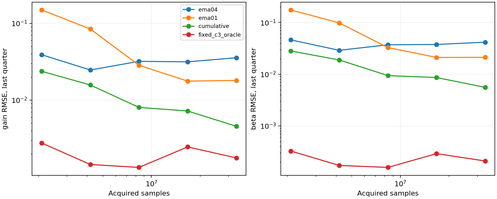
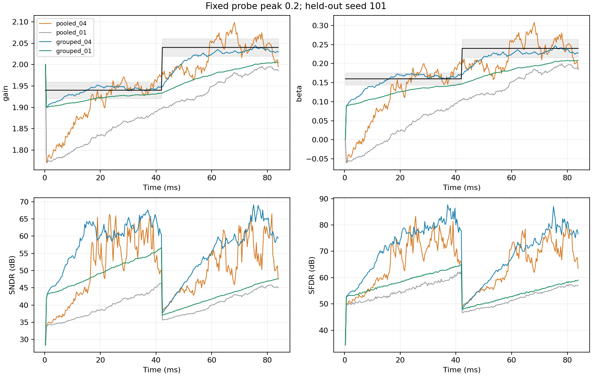

# 固定 Dither 幅度下的联合收敛诊断与改进

**硬件定位修正（用户约束）：** 本研究的分组矩、协方差加权及SVD方案仅保留为软件
诊断参考，不作为拟搬到硬件的校准实现。本文的SNDR/SFDR是浮点行为模型结果；
没有对应的晶体管级注入电路、定点RTL、综合面积/时序/功耗或硅验证。
后续实现必须先确定实际注入电容/参考/时序以及校准数字通路，优先采用少量相关累加、
移位与标量递推，并独立验证联合辨识和定点收敛，不能沿用本文性能作为硬件性能承诺。

日期：2026-11-01。承接[四种误差联合实验](2026-11-01-joint-dither.md)。
本次代码及上次新增代码尚未提交，重现应使用
[源码哈希与运行审计](joint-convergence-audit-20261101.json)，不能只依赖基础提交。

## 结论

原来的增益 G 与三次系数 beta 波动，主要来自**有限有效样本下的弱辨识与强耦合**。
没有发现本模型的三电子参数方程在理想独立激励下存在不可消除的结构偏差。
后端噪声和量化引起的偏差远小于本次观察到的波动；关掉记忆和电容失配也没有消除问题。

原权重 0.04 是相关矩的指数平均系数，不是梯度下降步长。固定权重时增加总运行时间，
不会无限积累有效样本；减小权重可以降低静态方差，但会延长启动和阶跃后的恢复过程。

在**峰值仍为0.2、权重仍为0.04、样本预算相同**的条件下，保留粗码分组相关矩，
再加权联合求解，显著改善了收敛。单音阶跃三个独立种子的末窗口全部满足原四参数误差带；
多音阶跃为89.58%，仍有越界块。这是本行为模型下的实测改善，不是任意输入下的收敛保证。

## 注入的到底是什么

```text
p[n] = (2*p31[n] + p29[n])/3
d[n] = 0.2*p[n]
d ∈ {-0.2, -0.0666667, +0.0666667, +0.2}
```

这是两路二值PN**逐点加权叠加**的四电平序列，不是时间拼接，也不是单路二值PN。
峰值0.2在 `u=w/2` 坐标中定义，理想等概率四电平的 RMS 为0.14907。
第三路独立二值PN `s` 控制电容换位，不作为另一项加性Dither叠加。
后端标准差0.0002的高斯噪声和13位量化是被校准路径的噪声，另于Dither。
本次所有正式对比均保持这套注入形式和幅度。

## 实验设计

探索只使用种子44。正式验证预先固定为101、202、303，没有根据正式结果再次调参。
每个种子测试单音、多音，恒定参数、四参数同时阶跃，共12组主实验。
每组256块，每块32768点，共8,388,608点；在100 MS/s时间标度下为83.88608 ms。
阶跃发生在41.94304 ms；估计器不知道阶跃时刻，不据此复位。

恒定参数使用 FINAL：`G=2.04, H=0.12, delta=0.012, beta=0.24`。
阶跃前使用 INITIAL：`1.94, 0.06, 0.006, 0.16`。注意上次实验的恒定参数使用 INITIAL，
因此本次恒定结果不能直接与上次恒定结果作同器件比较。

五种方法共享每一块实际采集值：原合并矩0.04、合并矩0.01、合并矩累计平均、
分组矩0.04、分组矩0.01。真值只进入被测对象和评估器。频率、干净输入不进入估计器。
当前块先使用旧系数校正，再更新供下一块使用。电容校准方程及保护条件沿用原设计。

另有每种子1024块的三条配对长记录：原有噪声/13位、零噪声/24位、零噪声/24位且
关闭记忆和电容失配。三者共享业务输入和PN序列。总计主实验100,663,296点、
诊断301,989,888点，不含探索和测试运行。完整轨迹、逐块相关矩、配置保存在示例
`output/joint_convergence_fixed02_20261101/`，可用入口脚本重新生成。

长记录诊断记录更新后的直接求解结果，不施加部署系数边界；主实验使用通过保护条件的
块开始时系数。因此两者的同长度末窗口数字会略有差别，长记录对照不用于声称实时输出性能。

## 样本量与平均权重

假设块相关矩独立且方差相同，指数平均的稳态方差等效样本数为：

```text
N_eff ≈ block_size * (2-alpha)/alpha
alpha=0.04 → 49块 → 1,605,632点
alpha=0.01 → 199块 → 6,520,832点
```

这是理想化等效数，不表示有限PRBS样本真的完全独立。首块权重为1，启动时也尚未
达到稳态等效数。恒定器件的长记录对比（各记录末四分之一窗口、三种子合并RMSE）：

| 方法 | 采集256块：G RMSE | 采集1024块：G RMSE | 采集256块：beta RMSE | 采集1024块：beta RMSE |
| --- | ---: | ---: | ---: | ---: |
| 原矩，alpha=0.04 | 0.03199 | 0.03562 | 0.03709 | 0.04161 |
| 原矩，alpha=0.01 | 0.02841 | 0.01805 | 0.03277 | 0.02117 |
| 原矩，累计平均 | 0.00803 | 0.00457 | 0.00937 | 0.00555 |

固定0.04下运行四倍时间仍存在方差底；累计平均才会持续保留新样本。
这不意味着累计平均适合跟踪：阶跃128块后，指数平均旧数据权重分别约0.54%和27.6%，
累计平均则仍保留全部阶跃前数据。单音阶跃末窗口，原0.04的SNDR为55.28 dB，
降到0.01后为46.26 dB，累计平均为42.47 dB；后两者四参数同时达标比例均为0。



## 耦合、数值条件和偏差分别检查

1. **弱辨识/耦合。** 原矩中 `r` 与 `r^3` 两列归一化后的夹角余弦约0.99988，
   列归一化矩阵条件数约152；单音阶跃末窗口G与beta误差相关系数平均0.99934。
   两个参数很容易互相补偿。固定逆三次系数 `c3=beta/G` 为真值的诊断中，
   1024块末窗口G RMSE从0.03562降到0.00177。这个含真值的对照只诊断耦合，
   没有用于实际校准或输出SNDR/SFDR。
2. **不是浮点求解精度问题。** 对同一组三方程作QR换基，解的最大差异仅
   `1.83e-15`。只做归一化或正交化不增加辨识信息，不能据此消除统计波动。
3. **后端噪声不是本次主要原因。** 1024块末窗口原方法G/beta RMSE分别为
   `0.035622/0.041607`；零噪声、24位时为 `0.035627/0.041614`，几乎相同。
   再关闭记忆和电容失配仍为 `0.034695/0.041122`。四误差同时打开并不是这种
   增益/三次耦合存在的必要条件。
4. **理想矩方程可辨识。** 精确枚举业务输入、当前/前一探针、电容换位的笛卡尔积，
   无噪声无量化时，原方法与分组方法都把G、H、beta恢复到约`1e-13`误差。
   这检验电子通路三参数；该非时序枚举不用于检验递归电容校正。
5. **存在小的测量噪声偏差，但量级不符。** 独立对称后端噪声使
   `c1_est = c1 - 3*sigma^2*c3`。默认sigma=0.0002时预测偏移仅`-1.41e-8`。
   对sigma=0.02的无量化枚举，实际偏移`-0.00014117647`与公式一致。
   13位量化的枚举控制中，G/beta绝对偏差不超过约`1.92e-4`，远小于原流式波动。

这些证据区分了本例内的机制；有限PRBS窗口与业务输入的偶然相关、比值映射及估计权重
仍可能引入有限样本偏差。并未排除实际电路里未知探针尺度、错误延迟、缺失非线性项等
模型误差。上述噪声公式也不涵盖任意信号相关噪声。

## 不增加幅度的改进及验证结果

原方法先在九种 `(q[n],q[n-1])` 粗码状态内对工具变量去均值，然后把所有状态的
相关矩合并成三条方程。新方法保留各状态的方程，最多27条约束辨识三个电子参数。
粗码由Dither注入前的输入决定，因而在本模型的独立激励假设下，这些额外条件矩是有效的。
不同状态提供不同的三次响应灵敏度，减少合并时丢失的信息。

用当前块开始时的系数形成残差协方差，采用相同0.04权重平均，再白化并以SVD联合求解。
这是可行广义矩估计；未建模全部时间相关性，不宣称权重最优。
完整公式与适用条件见[方法说明](../../python/src/adctoolbox/examples/11_calibration/JOINT_CONVERGENCE.md)。

以下为**本次相同数据**上的末64块结果，三个种子等权平均，不能与上次不同种子的
52.75 dB直接当作配对增益。四参数误差带沿用G 1%、H/delta/beta各10%。

| 单音阶跃指标 | 原合并矩0.04 | 分组矩0.04 |
| --- | ---: | ---: |
| SNDR，块dB均值 | 55.28 dB | **62.97 dB** |
| SFDR，块dB均值 | 71.02 dB | **77.75 dB** |
| G RMSE | 0.03083（1.51%） | **0.00702（0.34%）** |
| beta RMSE | 0.03603（15.01%） | **0.00827（3.45%）** |
| H RMSE | 0.00275 | 0.00209 |
| delta RMSE | 0.000473 | 0.000471 |
| 四参数同时达标块比例 | 51.04% | **100%** |

分组法单音阶跃的逐种子SNDR为61.47、63.49、63.95 dB；三个种子末64块各自全部达标。
四参数达标并不意味着已经达到后端噪声限：真参数校正仍有73.44 dB SNDR、105.42 dB SFDR。

| 场景 | 原矩→分组矩：信号/残差比 | 原矩→分组矩：四参数同时达标 |
| --- | ---: | ---: |
| 单音恒定 | 55.08 → 64.80 dB | 47.92% → 100% |
| 单音阶跃 | 55.28 → 62.97 dB | 51.04% → 100% |
| 多音恒定 | 51.70 → 58.42 dB | 30.73% → 93.75% |
| 多音阶跃 | 50.86 → 57.09 dB | 28.13% → 89.58% |

多音指标是全部目标音调功率与非目标残差功率的比值，不混称为标准单音SNDR。
多音阶跃的最大目标音调/最大杂散比从70.16升至73.87 dB。仍有约10.4%的末窗口块
未同时达标，不能写成全面解决。静态场景可以考虑更长累计平均；持续跟踪场景应优先
保留当前0.04并使用额外条件矩，而不是直接把平均权重降为0.01。

所有主实验过载数为0，最小后端归一化余量 **0.1128668**。各算法共享同一模拟采集，
所以改进没有额外消耗模拟余量。它增加了数字相关矩与权重计算，尚未评估片上实现成本。



## 代码、数据及验证

- [实验入口](../../python/src/adctoolbox/examples/11_calibration/exp_cal07_joint_convergence.py)
  与[分组矩估计器](../../python/src/adctoolbox/examples/11_calibration/joint_dither_convergence.py)。
- [跨种子汇总](joint-convergence-fixed02-20261101.csv)、
  [逐种子与窗口结果](joint-convergence-seeds-20261101.csv)、
  [长记录对照](joint-convergence-long-20261101.csv)、
  [平衡激励偏差对照](joint-convergence-bias-20261101.csv)。
- 7个新测试通过：与原合并估计器逐块数值一致、独立噪声偏差恒等式、满组合识别、
  缺激励/二值秩/过载保护、因果应用和CLI不覆盖输出；原联合实验10个测试也通过。
- 首次新测试的低幅度短记录同时触发电子参数越界，未能单独验证电容缺激励；将该测试
  改为常数内码输入以隔离保护条件后通过。未为通过测试放宽估计边界或误差带。
- 源码哈希全部匹配，主实验数值均有限，最大因果应用差值0；两张图已打开检查。

复现命令（需要NumPy、SciPy、Matplotlib，使用新的输出目录）：

```bash
python python/src/adctoolbox/examples/11_calibration/exp_cal07_joint_convergence.py --output output/joint_convergence
```
