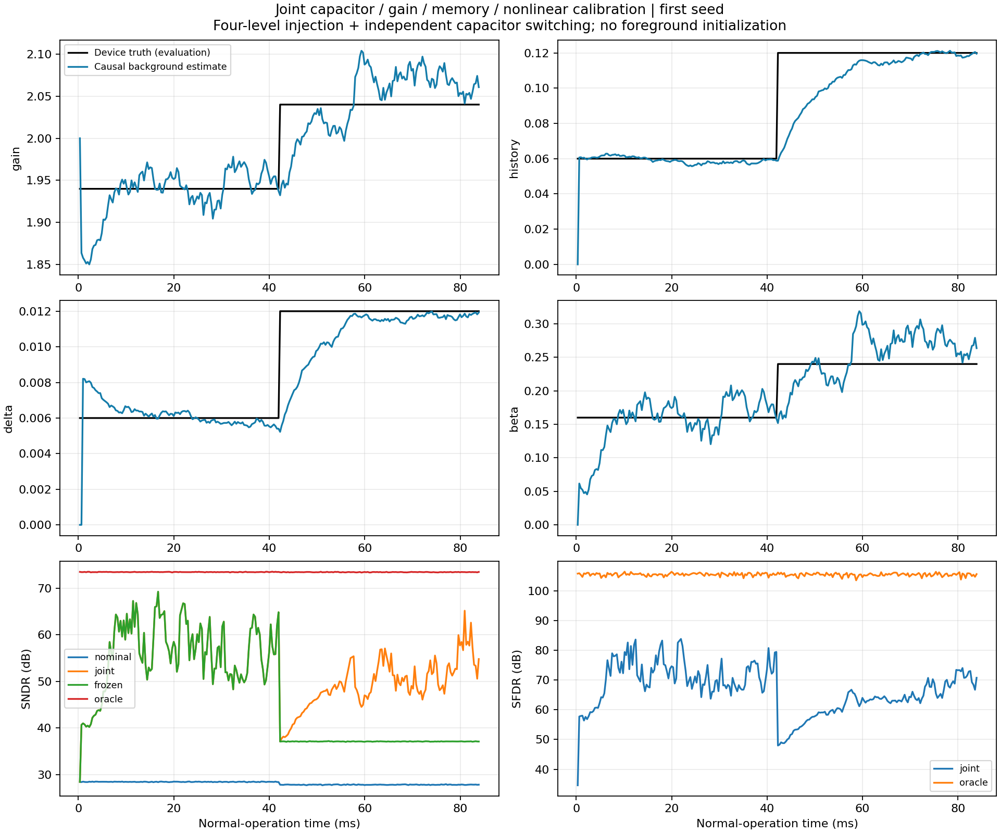
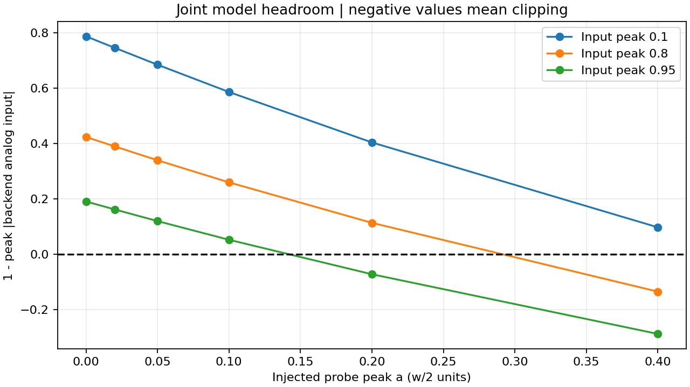

# 增益、记忆、电容失配与非线性同时存在的 Dither 联合测试

后续诊断与同幅度改进见[固定 Dither 幅度下的联合收敛研究](2026-11-01-joint-convergence.md)。
本文保留原方法与原种子的历史结果。

日期：2026-11-01。基础提交：`8e6f54136d6acbcd13b2ccc6bf8010b1a9027dbb`。
本次新增源码尚未提交；实际文件 SHA-256 和运行环境保存在
[审计清单](joint-dither-audit-20261101.json)，不能仅用基础提交重现本次实验。

## 结论

四种误差可以在同一条行为转换路径上建立自洽的可观测辨识方程，且联合校正明显改善
SNDR/SFDR。但本次固定数据预算下，**尚未证明四个参数能够稳定联合收敛**。

默认探针峰值 a=0.2、输入峰值0.8，三个种子的单音阶跃末窗口平均结果为：

- 名义重建：SNDR 27.81 dB、SFDR 33.95 dB；
- 联合后台：SNDR **52.75 ± 1.90 dB**、SFDR **67.36 dB**；
- 真参数校正：SNDR 73.45 dB、SFDR 105.35 dB；
- 所有主实验均无后端过载，最小归一化余量 **0.11289**。

末窗口内，记忆系数和电容失配逐块满足预设误差带；增益和三次系数仍显著波动。
单音阶跃下四个参数同时达标的块比例只有 **36.46%**（三个种子合计）。因此不能把
“每块返回 updated”“矩阵满秩”或“平均估计接近真值”写成稳定收敛。

## 模型与方法

代码入口：
[exp_cal06_joint_dither.py](../../python/src/adctoolbox/examples/11_calibration/exp_cal06_joint_dither.py)。
完整推导和接口边界见
[JOINT_DITHER.md](../../python/src/adctoolbox/examples/11_calibration/JOINT_DITHER.md)。

本例采用一个1.5-bit两电容粗级，名义余量增益为2。没有将原增益4示例与电容级的
增益2重复相乘。二值序列s控制电容角色，独立四电平序列p用于模拟注入：

```text
Cf = 1-delta*s, Cs = 1+delta*s, q in {-1,0,1}
w = (2*x-(1+delta*s)*q)/(1-delta*s)
v = w/2+a*p
r_analog + beta*r_analog^3 = G*v[n]+H*v[n-1]
r = Q13(r_analog + noise)
```

非线性作用于包含记忆的总响应；上一拍状态也包含上一拍电容切换和探针，因此四种
误差在同一转换路径中相互作用。注入幅度a定义在w/2坐标，假设电荷重分配之后存在
已知尺度的理想加法注入。若实际注入电容的尺度随Cf变化，必须另行建模。

令c1=1/G、c3=beta/G、h=H/G，选取当前PN、三次PN和延迟PN作为工具变量：

```text
Z = [p, p^3-(41/45)*p, p_previous]
Cov(Z, [r, r^3, -a*p_previous]) @ [c1,c3,h] = Cov(Z,a*p)
```

成立条件是PN与当前和过去业务余量外生，且后端噪声/量化相关误差足够小。当前实现
还在每个可观测(q,q_previous)组合内对Z去均值，以去除组内常量干扰；这不保证方差
总会下降，实验保留了不分组去均值的对照。

数字校正顺序为：逆三次映射 → 逆记忆滤波 → 减去注入PN → 电容失配校正。
电容失配用恢复后的余量及码加权切换序列估计。该估计也使用当前块开始时可用的
电子路径参数，更新仅用于下一块。没有使用理想输入标签、真参数或测试频率训练。

这是一套为联合模型重新推导的三参数电子路径辨识＋电容辨识流程，不是把原来几个
孤立估计器未经修改地同时接在原始后端码上。其数学可辨识性由独立笛卡尔积代数测试
验证；实际连续序列中的有限样本表现则由下面的实验检验。

## 实验条件与对照

主实验12组：单音/双音 × 固定/阶跃 × seeds 11、22、33。每组256×32768点，
约83.88608 ms@100 MS/s；无前台初始化。四个误差参数在阶跃案例的中点同时改变。

| 物理参数 | 初始 | 阶跃后 |
| --- | ---: | ---: |
| G | 1.94 | 2.04 |
| H | 0.06 | 0.12 |
| delta | 0.006 | 0.012 |
| beta | 0.16 | 0.24 |

后端13 bit、范围[-1,1]，后端输入噪声RMS 0.0002。单音峰值0.8、频率取最接近
0.137fs的奇数FFT bin；双音峰值0.46/0.34、频率约0.083fs/0.217fs。电子路径与
电容矩均按0.04指数平均。PN、模拟历史、数字逆滤波状态和波形相位跨块连续。

所有probe-on方法使用同一捕获，包括名义参数、联合后台、未做粗码条件去均值的
联合后台、中点冻结后台、真参数对照。另有使用同一组联合估计、分别关掉记忆、电容
或非线性校正的消融，以及只保留增益校正的消融。**消融不是重新训练的独立算法。**

配对probe-off器件保留电容角色切换，使用相同噪声序列；只关闭额外加法PN。
真参数只用于oracle及评价。输出频谱不先拟合/去除增益误差；另存对真输入的error-SNR。

参数验收带在完整实验运行前固定：G相对误差≤1%，H、delta、beta各≤10%。
记录实际用于当前块的参数、末窗口达标率，以及每半段首次连续8块全部达标的时刻；
首次出现这样的连续段不意味着后续一直达标。

开发阶段发现a=0.1的三次相关信息过弱，因此主实验采用a=0.2，同时保留a=0.1、
a=0.25的完整同预算对照，各为单音/阶跃/三个种子。总计18组、4608块、150,994,944点。
没有为了结果更好而放宽验收带或挑选最佳种子。种子只改变序列和噪声，不是器件Monte Carlo。

## 结果

以下均为最后四分之一窗口的每块dB均值，再跨三个种子平均。

| 条件 | 名义SNDR/信号失真比 | 联合后台 | 真参数对照 | 联合SFDR/最大杂散比 |
| --- | ---: | ---: | ---: | ---: |
| 单音，固定 | 28.42 | 54.16 ± 2.03 | 73.47 | 69.01 |
| 单音，阶跃 | 27.81 | 52.75 ± 1.90 | 73.45 | 67.36 |
| 双音，固定 | 26.65 | 53.10 ± 3.69 | 70.72 | 73.78 |
| 双音，阶跃 | 26.38 | 52.25 ± 3.98 | 70.79 | 71.97 |

单位dB；±为种子间SD，不是置信区间。双音使用总期望信号/噪声失真与最强期望音/
最大非期望bin，不把它们称为单音SNDR/SFDR。噪声主导的最大bin值随FFT长度变化。

单音阶跃消融及冻结对照：

| 校正路径 | SNDR | SFDR |
| --- | ---: | ---: |
| 仅使用联合估计中的增益 | 27.08 | 33.13 |
| 不校正记忆 | 33.75 | 40.92 |
| 不校正电容失配 | 41.17 | 67.06 |
| 不校正非线性 | 28.63 | 36.58 |
| 联合后台中点冻结 | 37.86 | 48.72 |
| 完整联合后台 | 52.75 | 67.36 |
| 联合后台，不对粗码条件去均值 | 55.31 | 68.92 |

不校正电容时SFDR变化很小、SNDR明显下降，符合随机交换将失配误差扩散为噪声的表现。
条件去均值在这些记录中并未普遍提高性能：单音阶跃约落后不分组版本2.56 dB；保留
该对照，不能将“减少常量干扰”的代数性质推广为总方差必然更小。

默认幅度、单音阶跃末窗口的物理参数：

| 参数 | 真值 | 时间/种子平均估计 | 合并RMSE | 各参数独立达标块比例 |
| --- | ---: | ---: | ---: | ---: |
| G | 2.04 | 2.03130 | 0.03352 | 38.02% |
| H | 0.12 | 0.11719 | 0.00353 | 100% |
| delta | 0.012 | 0.01180 | 0.000359 | 100% |
| beta | 0.24 | 0.22878 | 0.03935 | 36.98% |

四项同时达标率36.46%。双音阶跃对应比例32.81%。增益和非线性参数的平均值接近
真值，但单块波动仍大，二者是当前限制。矩阵可解与正斜率/稳定性保护不能替代这种
统计验收。有限高阶相关信号较弱是重要限制；本轮没有将所有残差归因于单一原因。



## 探针幅度与余量

相同单音阶跃、三个种子、相同样本预算：

| 探针峰值a | 联合SNDR | 联合SFDR | 全程最小后端余量 | 四参数同时达标率 | 过载 |
| --- | ---: | ---: | ---: | ---: | ---: |
| 0.10 | 39.84 | 47.83 | 0.25907 | 3.65% | 0 |
| 0.20 | 52.75 | 67.36 | 0.11289 | 36.46% | 0 |
| 0.25 | 55.70 | 71.62 | 0.04580 | 68.23% | 0 |

余量定义为1−max|后端量化前模拟电压|，包含后端噪声；后端单边满幅为1。
增大探针改善了这一模型中的高阶辨识，但a=0.25仍未稳定联合达标，且可用余量已很小。

独立余量扫描覆盖输入峰值0.1/0.8/0.95、a=0/0.02/0.05/0.1/0.2/0.4，以及
初始/最终器件参数，共36个条件，每个32768点。真实失败案例包括：

- 输入峰值0.8、a=0.4、最终参数：3248点过载，余量约−0.13485；
- 输入峰值0.95、a=0.2、最终参数：1606点过载，余量约−0.07208。

两者都根据可观测rail码冻结整块更新。保护工作正常，但截断样本不能被校正恢复。
因此“默认输入没有过载”不能推广为接近满幅输入安全。



## 失败控制和验证

- 二值PN使两个当前奇次工具变量共线：电子路径`held_rank`，电容路径也不假装成功；
- 只访问中间粗码：电子路径可以更新，电容路径`held_excitation`；
- 实际注入幅度0.11、假设0.1：短控制记录估计G约2.2649，真值2.04，且仍返回updated；
- PN错一拍：`held_bounds`，不能把序列存在当作对齐正确；
- 过载控制：两个估计器均`held_rail`，真过载计数不传入Tracker。

10项新增测试覆盖连续流/阶跃逆变换、精确三参数矩识别、真实流电容估计、秩与激励
失败、可观测rail保护、已知谐波指标、因果运行和CLI导出/拒绝覆盖。原有35项Dither
测试也通过。24-bit无噪声联合逆校正误差小于5e-8；这验证方程和状态实现，不代表
有限样本估计能达到该精度。

本次独立审计所有18组、4608块：数值有限，当前块所用参数严格等于上一块更新值，
重新计算全部窗口/聚合值一致，所有运行清单中的源码哈希与当前文件一致。
已从隔离源码树构建wheel，确认新脚本、模型与说明被包含，且没有output或字节码；
从wheel提取的独立示例执行成功。工作区常规构建曾混入原有build目录中的旧产物，
因此这里的打包验证明确使用干净、独立的源码目录，不据此声称现有脏构建目录已修复。

## 复现与文件

在仓库根目录运行，输出目录需为空或不存在：

```powershell
.\python\.venv\Scripts\python.exe python/src/adctoolbox/examples/11_calibration/exp_cal06_joint_dither.py --output python/src/adctoolbox/examples/11_calibration/output/joint_dither_acceptance_20261101
.\python\.venv\Scripts\python.exe python/src/adctoolbox/examples/11_calibration/exp_cal06_joint_dither.py --amplitude .1 --waveforms sine --scenarios step --output python/src/adctoolbox/examples/11_calibration/output/joint_dither_weak_probe_20261101
.\python\.venv\Scripts\python.exe python/src/adctoolbox/examples/11_calibration/exp_cal06_joint_dither.py --amplitude .25 --waveforms sine --scenarios step --output python/src/adctoolbox/examples/11_calibration/output/joint_dither_strong_probe_20261101
```

原始逐块轨迹、配置、全部对照和故障诊断在上述output目录（Git忽略）中。
纳入版本管理的精简证据：

- [完整聚合结果](joint-dither-20261101.csv)
- [参数均值、RMSE与达标率](joint-dither-parameters-20261101.csv)
- [余量扫描](joint-dither-headroom-20261101.csv)
- [源码、环境与独立审计清单](joint-dither-audit-20261101.json)

测试命令，在python目录执行：

```bash
uv run --no-sync --with pytest python -m pytest tests/unit/test_joint_dither.py tests/unit/test_dither_mechanisms.py tests/unit/test_dither_background_example.py -q
```

## 成熟度和下一步

本轮完成了“同时存在四种误差”的联合测试，支持继续保留为研究示例。其正面结果是
可观测联合方程自洽、校正收益明确、余量失败可检测；未通过的部分是固定预算下的
稳健参数收敛和接近oracle的性能。不能仅凭SNDR改善就升级为通用公共API。

下一步应针对增益/三次系数的方差和相互耦合，比较更长平均时间、多工具变量/不同
探针设计及跟踪速度的代价；同时增加非三次逆、非线性记忆和注入尺度随电容变化的
独立模型。当前模型仍是理想电荷重分配、两抽头线性记忆和精确三次逆的组合，没有
证明实际芯片的PVT、固定点、面积功耗或多级联合性能。
