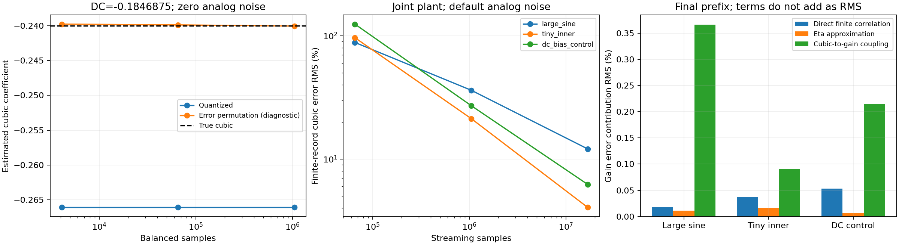

# HDC相关性补充实验：偏差来源与有限记录误差

本批先补相关性证据，保持三路等权PN峰值0.2，不修改Tracker更新规则，也不实现RD。小幅输入/DC是新增的适用边界研究，不作为原仓库功能回归失败。原上游已有[前台位权校准幅度扫描](../../python/tests/unit/calibration/test_verify_calibration_lite.py)，覆盖−60至0 dBFS；它不是HDC的DC偏置/PN相关实验。

代码入口：[hdc_correlation.py](../../python/src/adctoolbox/examples/11_calibration/hdc_correlation.py)。该脚本读取仿真内部真值做误差归因，输出的是**未施加参数边界的原始浮点矩估计**，不是Tracker最终提交的系数。打乱量化误差等操作仅作诊断，不能直接作为硬件校准输入。

## 实验配置

使用独立种子601、702、803，试跑种子44只检查执行。连续LFSR记录取2¹⁶、2²⁰、2²⁴点的嵌套前缀；前缀共用样本，不是独立重复试验。

| 变量 | 取值 |
|---|---|
| 输入 | 峰值0.78正弦；0.137+1e−5正弦；DC=−0.1846875 |
| 模型 | 仅增益/三次项；加入原有记忆和DAC失配的联合模型 |
| 后端模拟噪声RMS | 0、默认0.0002 |
| 后端量化 | 不量化、13位、24位，使用同一份模拟捕获 |
| Dither | 三路31/29/23位LFSR，峰值0.2 |
| 物理参数 | G=2.04、k=−0.24；联合模型另有H=0.12、δ=0.012 |

共36条物理采集路径，输出324条流式统计记录。DC点来自上一批已知的偏差边界，用于针对性验证，不代表正常输入的概率分布。所有流式路径零过载，最小模拟余量0.04048。

另外枚举256个输入相位、8种PN状态及独立参考的±1状态，形成4096点平衡表，重复1、16、256次，共27条平衡统计记录。三种子文件里的平衡表完全一致，导出时只保留一份。

## 严格分离三次估计误差

记 `r0=g(z+d)+k(z+d)³`、`g=G/2`、`c3=p1p2p3`，n为r坐标下模拟噪声，e为后端量化误差。每个有限记录都满足：

```
k_hat−k = [mean((r0−d)c3)/(6A³)−k]
          + mean(n c3)/(6A³)
          + mean(e c3)/(6A³)
```

三项分别是有限记录的模拟信号/PN相关误差、模拟噪声相关项和量化误差相关项。第一项继续展开为输入泄漏、d的一次项、二次项和三次PN矩的不平衡。所有分项的有符号和必须重建总误差，不能只凭曲线外观判断原因。

本批三次分解恒等式最大残差3.38e−14，第一项内部展开最大残差7.45e−15。没有把某一项拟合成另一项，也没有向学习器提供真实输入或真实误差；这里根本不执行新的学习器。

## 对照一：重复样本不能消掉固定量化相关

在孤立模型、DC=−0.1846875、模拟噪声为零、13位后端的平衡表中：

| 样本数 | 三次估计 | 量化相关造成的系数偏差 | 只打乱量化误差后的剩余偏差 |
|---:|---:|---:|---:|
| 4096 | −0.266075 | −0.026075 | +0.000242 |
| 65536 | −0.266075 | −0.026075 | +0.000126 |
| 1048576 | −0.266075 | −0.026075 | −0.000039 |

真实k=−0.24。平衡表中 `mean(c3)=0`，所以这里不是c3数量不平衡；量化误差与c3的中心化相关系数约−0.935。条件均值分别为：

```
mean(e | c3=+1) = −5.43783e−5
mean(e | c3=−1) = +3.83333e−5
```

两组误差与参考相乘后同向累积。重复同一组状态保留偏差。误差置换保持整组量化误差的直方图、均值和RMS，改变它与PN的配对，因而大幅减小这项偏差。流式置换仅在每个固定块内进行，不会消除原本的模拟信号泄漏。

如果把整个辨识参考换成独立序列，平衡表的三次估计则为0：真实的−0.24也丢失了。独立参考在每个输入/PN组合上都枚举±1，避免把有限参考均值的DC泄漏误当成期望结果。流式负对照另用19位LFSR，保留真实的有限记录波动。

这两个控制支持“抑制特定误差相关，而保留有效辨识相关”的目标，不构成新的可实现去相关电路。

## 对照二：当前默认噪声下，有限记录项占主导

下表为联合模型、默认模拟噪声0.0002、13位后端、2²⁴点记录的三种子RMS。各数值均为三次系数的**绝对误差贡献**，不是百分比：

| 输入 | 有限记录项RMS | 量化相关项RMS |
|---|---:|---:|
| 大正弦 | 0.029070 | 0.00000204 |
| 0.137附近微小正弦 | 0.009756 | 0.00000379 |
| DC边界点 | 0.014982 | 0.00000565 |

在这些条件中，有限记录项主要来自输入信号泄漏 `mean((g*z+k*z³)*c3)/(6A³)`。不量化的参考路径仍然存在它；单纯提高后端位数不能解决这部分误差。

微小正弦案例的有限记录项RMS随N=2¹⁶、2²⁰、2²⁴依次为0.23180、0.05114、0.00976。它在本批记录中随样本量明显减少，但三种子不足以证明所有种子/输入都服从严格的收敛速率。
该分项是未量化记录相对理想PN期望的差值，也不能据此断言所有确定性LFSR相关在无限记录下都严格为零。

无模拟噪声的孤立DC控制则不同：三个记录长度的量化相关项均值约−0.026077，基本不变。加入默认模拟噪声后，该项在最长记录上的均值降到约−4e−6；但有限记录项仍在。这说明默认噪声可以弱化这个特定量化相关，同时并未解决全部辨识误差。不能据此建议无条件增加噪声，也不能从本批相关量推导SNDR提升。

联合模型的记忆改变了后端访问的电平，量化相关也随之改变。例如同一DC点、无模拟噪声时，最长记录的量化相关项均值约+0.007188。不能把孤立模型的−0.026075直接套到联合模型。

## 增益与三次系数的耦合

现有增益公式为 `g_hat=1+gamma1−(7A²+3eta)k_hat`。本批将它进一步拆成线性相关的有限记录误差、模拟噪声、直接量化项、eta近似，以及三次估计误差传播：

```
gain_error = B1 + mean(n*p1)/A + mean(e*p1)/A
             + 3k(mean(z²)−eta) − (7A²+3eta)(k_hat−k)
```

其中B1是未量化线性相关矩相对其理想期望的有限记录误差。最大恒等式残差6.20e−16。

在上述平衡DC控制里，归一化增益误差约0.003716，其中三次误差传播项约0.003492。联合模型默认噪声下，最长记录的三种输入也都表现出三次到增益传播项的RMS大于eta近似项。因此观察到增益与三次系数同时变化，并不意味着它们各自存在一个独立的数值故障。

分项之间可能抵消；表中或图中的RMS不能直接相加。这里的g是G/2，不能把其绝对误差直接当成物理级间增益G的绝对误差。

## 复现与验证

```powershell
cd python
uv run --no-sync python src/adctoolbox/examples/11_calibration/hdc_correlation.py --output ../agent_playground/hdc-correlation-new
```

正式执行将三个种子分进独立进程，每个进程约147–149秒；每个进程的参数和源文件哈希保存在[审计JSON](hdc-correlation-audit-20261102.json)，运行前后哈希一致。Numba不是本诊断的必需依赖。

- [全部流式相关量及误差分项](hdc-correlation-streaming-20261102.csv)
- [平衡/置换/独立参考控制](hdc-correlation-balanced-20261102.csv)
- [三种子均值和RMS](hdc-correlation-summary-20261102.csv)

本批新增8项机制测试；与已有HDC及小幅输入测试合计39项通过。测试检查诊断模型与既有Plant逐样本一致、误差恒等式、置换与独立参考的不同作用，以及CLI产物和禁止覆盖。Sphinx严格构建通过。
wheel和源码包构建成功；从wheel复制示例后，在无Numba的独立环境运行快速模式，六条采集路径均完成，生成的源文件审计检查通过。快速模式只验证安装和执行，不替代正式记录。

这些结果支持先区分误差来源再决定修改目标：默认模型的主要有限记录误差与无噪声边界的量化相关偏差，是两类不同问题。本批没有更改PN构造、增加注入峰值、实现2013 RD，或重新宣称硬件资源和普遍收敛能力。


