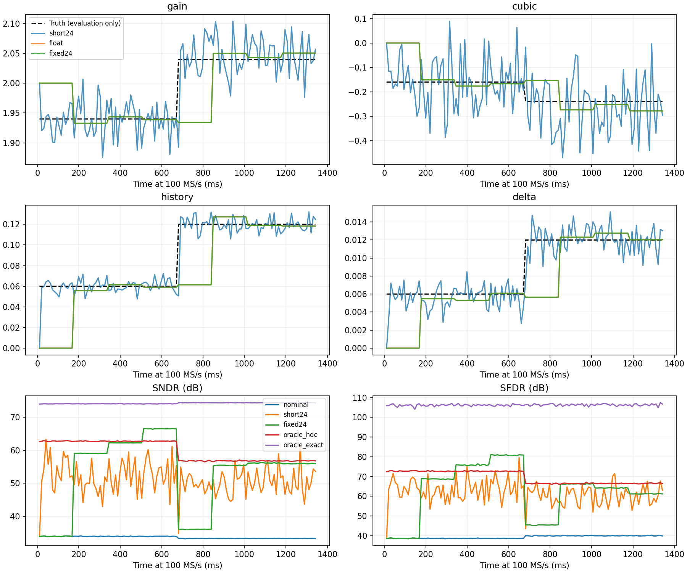
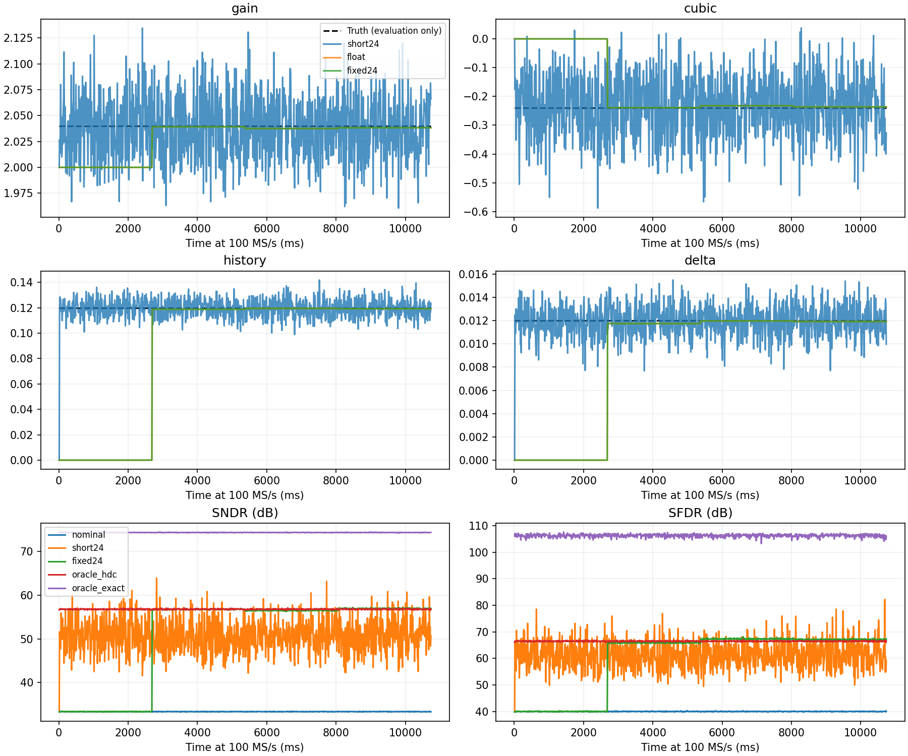

# 三路 PN HDC 定点联合校准实验

已实现并运行三路等幅 PN、符号相关累加、定点 HDC 增益/三次校正，以及一阶记忆和两单元 DAC 电容失配的联合校准。**Dither 模拟峰值始终为 0.2。** 这是一套可明确映射到乘法器、累加器和寄存器的算术架构；目前没有 RTL 综合、时序收敛或晶体管级验证。

主要结论：长窗口可以在不增加 Dither 峰值的情况下明显改善参数辨识；24 位小数定点不是当前收敛瓶颈。三次近似逆仍留下较大高阶残差，而且输入峰值 0.8 的直流/低频工况没有足够模拟余量。这两项限制都不能靠延长累加或增加小数位解决。

## 方法和物理模型

HDC 核心依据 [Panigada / Galton，JSSC 2009，公式 (8)–(11)](https://ispg.ucsd.edu/uploads/2017/05/2009-JSSC-A.-Panigada-A-130-mW-100-MSps-Pipelined-ADC-With-69-dB-SNDR-Enabled-by-Digital-Harmonic-Distortion-Correction.pdf)。论文中的芯片是方法存在物理实现的依据；本实验没有复现整片 ADC。记忆和电容相关器是本项目推导的扩展，不能称为论文已经验证的同一联合电路。

- 三路注入：`d=(p1+p2+p3)/15`，每路为 ±1 的 PN。总电平为 ±0.2、±1/15，理想概率为 1:3:3:1；与之前两路加权 PN 的等概率四电平不同。
- 三个注入 LFSR 分别为 31、29、23 位；另有一个 27 位 LFSR 选择 DAC 电容，后者不构成第四路模拟注入。
- 固定反馈电容 `Cf=15Cu`，采样电容 `Cs=30Cu`，两个 DAC 电容 `15(1±δ)Cu`，三个注入电容各 `2Cu`。理想电荷关系为 `backend=2x−(1+δs)q+(2/15)Σp`。这里 0.2 是归一化输入/余量坐标中的峰值，理想后级探针峰值为 0.4。
- 正向三次模型：`r=(G/2)t+k t³`，`t=v+(H/G)v_previous`，`v=x−(1+δs)q/2+d`。后级量化 `2r`，13 位，模拟噪声 RMS=0.0002。
- 初值 `(G,k,H,δ)=(1.94,−0.16,0.06,0.006)`；阶跃后为 `(2.04,−0.24,0.12,0.012)`。四项同时变化，所有模拟/数字状态和 PN 连续运行。

**本次采用固定反馈电容和正向三次模型。** 之前的电容角色互换、精确逆三次模型与之不同，旧的 β 不能直接当作这里的 k。因此本报告只比较同一新模型、同一捕获数据下的各条路径，不把数值提升归因于更换校准算法后优于旧模型。

注入电容比、参考幅度暂按已知处理；电容失配覆盖一个两单元 DAC 误差模式，记忆覆盖一个线性抽头。注入电容误差、复杂 DAC 误差分布、非线性记忆、开关寄生和真实建立过程尚未验证。详细方程、位宽和电荷解释见 [HDC_FIXED.md](../../python/src/adctoolbox/examples/11_calibration/HDC_FIXED.md)。

## 测试条件和统计口径

主测试：单音、双音各用种子 101/202/303，每例 2^27 点，中点同时改变四项误差；同一数据比较浮点、24 位小数定点、短窗口、未校准和两个真参数参考。单音约 0.137fs，双音约 0.083fs/0.217fs；总输入峰值 0.8。

额外长窗口：独立种子 404、单音、恒定终值误差，2^30 点、四个 2^28 点累加窗口。它验证较长统计窗口，不等于多种子、多 PVT 的硬件资格验证。每个窗口算完后再等待 512 个采样时钟提交参数。

定点主格式为有符号 28 位、24 位小数。主测试累加器 52 位，长窗口累加器 56 位。未使用梯度下降，因此没有 LMS 步长；更新的方差和跟踪速度主要由累加窗口决定。

频谱用 32768 点相干 FFT，不加窗、去 DC。表中是最后四分之一记录内各次 FFT 的 dB 均值；主测试再对三个种子求均值。双音仅报告“目标音总功率/其余功率”和“最强目标音/最大杂散”，不冒称单音 SNDR/SFDR。真值只用于评估，不输入估计器。

## 频谱结果

单音结果，单位 dB：

| 同一捕获数据内的路径 | 主测试 SNDR | 主测试 SFDR | 长窗口测试 SNDR | 长窗口测试 SFDR |
|---|---:|---:|---:|---:|
| 未校准，已减名义 Dither | 33.33 | 39.99 | 33.32 | 39.98 |
| 定点，2^20 点/更新 | 51.04 | 61.33 | 50.85 | 61.58 |
| 定点长窗口：主测试 2^24，额外测试 2^28 | **55.76** | **66.18** | **56.93** | **67.12** |
| 相同长窗口，浮点 | 55.76 | 66.18 | 56.93 | 67.12 |
| 真参数代入同一 HDC 三次近似逆 | 56.79 | 66.49 | 56.79 | 66.49 |
| 真参数精确逆，仅评估用 | 74.36 | 106.29 | 74.36 | 106.26 |

双音主测试的两个对应比值由 **30.73/42.63 dB** 改善到 **56.73/70.92 dB**；真参数 HDC 近似逆为 57.90/73.10 dB，精确逆参考为 71.55/101.51 dB。

真参数近似逆是残差对照，并非数学意义上的最高可达 SNDR。略有偏差的系数可能部分补偿被省略的高阶项，所以估计器某些记录可略高于这个对照。精确逆使用 Newton 迭代和真值，只是诊断参考，没有纳入硬件版本或资源预算。

## 收敛和定点精度

长窗口最后实际使用的估计值：

| 参数 | 真值 | 估计值 | 相对绝对误差 |
|---|---:|---:|---:|
| G | 2.040000 | 2.038281 | 0.084% |
| k | −0.240000 | −0.236404 | 1.50% |
| H | 0.120000 | 0.119179 | 0.68% |
| δ | 0.012000 | 0.011921 | 0.66% |

预设评估带为增益 1%、其他三项各 10%。长测试的四次窗口估计全部在带内；第四次在记录末尾产生，尚未被输出路径使用，上表及末段频谱使用第三次估计。四次 k 估计范围为 −0.23882 到 −0.23060。这个结果支持在该工况下稳定进入误差带，不能表述为参数精确、无偏收敛。

2^24 点窗口仍不充分：三种子单音末段 k 的相对 RMSE 分别约 11.81%、14.60%、2.54%；增益约 0.38%、0.54%、0.17%。不能把三次系数“总体曲线看起来平稳”当成全部种子都已达标。2^20 点单音短窗口的平均频谱只有约 51 dB。

在 100 MS/s 的时间换算下：2^20、2^24、2^28 点分别是 **10.49 ms、167.77 ms、2.684 s/更新**，再加 5.12 µs 控制延迟。100 MS/s 是行为模型时间基准，尚未证明该组合逻辑能达到此时钟。

所有正常单/双音主测试和长测试的定点乘法、输出、累加器、控制器饱和次数均为 **0**。24 位小数与浮点的末段 SNDR 均值差：六个主测试最大 0.00073 dB，长测试 0.00104 dB。

长测试的位宽对照使用同一捕获数据：

| 小数位 / 总位宽 | SNDR | SFDR | k 估计 |
|---|---:|---:|---:|
| 16 / 20 | 57.37 | 65.90 | −0.245613 |
| 20 / 24 | 56.93 | 67.10 | −0.236335 |
| 24 / 28 | 56.93 | 67.12 | −0.236404 |
| 浮点 | 56.93 | 67.12 | −0.236418 |

16 位小数改变了很小的三阶相关均值和 `6A³` 分母，已能看到系数偏移；单个 SNDR 数字略高不能证明它更准确。当前资源预算保留 24 位小数。20 位小数显示出缩减位宽的可能，但还没有相同规模的多种子验证。

## 样本误差、辨识耦合与公式偏差

1. **有限样本是三次系数波动的主要来源。** 三路等幅 PN 的三阶统计要除以 `6A³=0.00177778`，残余输入相关被明显放大。延长窗口有效，24 位定点与浮点重合也排除了大部分字长问题。
2. **理想三次项本身可辨识。** 完全枚举 PN、前一拍 PN、电容选择和输入相位的控制实验中，不量化时三次系数误差在 10^-13 内，即使记忆和电容失配同时存在也如此。这里是分析用的精确期望，不是额外硬件训练数据。
3. **增益存在 HDC 近似偏差。** 论文用 `eta=E[(r−d)²]` 近似 `E[z²]`。实际得到 `G_hat−G=6k(E[z²]−eta)`；联合无量化枚举中的误差为 −0.00046358，与这个表达式一致。延长窗口不能去掉它。
4. **量化和近似逆仍会影响联合路径。** 枚举控制加入 13 位量化后，联合三次项误差约 −0.0004265。记忆/电容相关器还受到不完全逆校正的影响。近似逆省略的五次及更高项解释了与精确逆参考之间的大部分频谱差距。

因此本版改善方式是“更长的相关累加 + 足够字长”，而不是更复杂的矩阵算法。它解决了明显的统计波动，但没有消除全部模型偏差。

## 注入余量与失败工况

主测试各点 Dither 峰值均为 0.2，单音/双音过载数为零。以后级满量程幅值 1 为基准，最小实测余量分别为 **0.005647（0.565%）**、**0.011304（1.130%）**；长单音为 0.005649。这些余量不宽裕。

针对性范围测试，每种 65536 点，同样保持 Dither 峰值 0.2：

| 输入 | 最小余量 | 过载样本 | 处理 |
|---|---:|---:|---|
| DC +0.8 | −0.01970 | 2114 | 冻结窗口 |
| DC −0.8 | −0.01966 | 2061 | 冻结窗口 |
| 低频正弦，峰值 0.8 | −0.01962 | 132 | 冻结窗口 |
| DC +0.78 | +0.01509 | 0 | 可更新 |

最终模型在最坏同号历史下，0.8 输入的无噪声后级峰值上界为 **1.019142**。维持当前探针幅度、参考范围和模型参数，零噪声输入上限为 **0.788947**；预留 6σ 模拟噪声后约为 **0.788258**。这里的高斯噪声没有绝对上界，6σ 只是工程余量。

可实施的范围选择是把允许输入峰值降到约 0.78，或为后级增加范围/冗余；报告没有悄悄改变主测试输入来掩盖削顶。0.78 此次只做了范围对照，没有重新做完整长窗口频谱资格验证。还需另外给 PVT、参考和注入电容误差留余量。

## 硬件预算

单级、28 位乘法操作数、2^28 点窗口：

| 硬件 | 数量 |
|---|---:|
| 采样速率通用乘法器 | **6**：HDC 4、记忆 1、二阶矩 1 |
| 慢速共享乘法器 | **1** |
| 56 位符号相关累加器 | **5** |
| 29 位非零码计数器 | **1** |
| 慢速共享串行除法器 | **1**，57 位被除数/商 |
| 寄存器总状态 | **1456 位，43 个不同宽度的寄存器向量** |

寄存器总数已经包含累加器、PN、快照、系数及控制状态，不需要再次把累加器加上去。2^24 点版本使用 52 位累加器，总寄存器 **1401 位**。相关乘 ±1、三路 PN 乘积、乘 q/2 和电容修正均使用符号选择/XOR/移位，不额外计通用乘法器。六次串行除法可共享一个单元，窗口更新期间继续采样。

这是一份明确架构的逻辑预算，不是综合网表数字；没有把一个 28×28 逻辑乘法器说成一个 FPGA DSP，也没有计入后级 ADC、IO、调试状态、额外流水线和对齐延迟。逐项寄存器明细见 [资源 JSON](hdc-fixed-resources-20261102.json) 和 [实现说明](../../python/src/adctoolbox/examples/11_calibration/HDC_FIXED.md)。

## 文件、重现和验证

- 实现：[hdc_fixed.py](../../python/src/adctoolbox/examples/11_calibration/hdc_fixed.py)；完整运行入口：[exp_cal08_hdc_fixed.py](../../python/src/adctoolbox/examples/11_calibration/exp_cal08_hdc_fixed.py)。
- 范围/偏差控制：[hdc_fixed_controls.py](../../python/src/adctoolbox/examples/11_calibration/hdc_fixed_controls.py)。命令见实现说明。
- [逐种子频谱 CSV](hdc-fixed-performance-20261102.csv)、[参数误差 CSV](hdc-fixed-parameters-20261102.csv)、[长窗口四次估计 CSV](hdc-fixed-long-updates-20261102.csv)。
- [余量控制 CSV](hdc-fixed-headroom-20261102.csv)、[余量边界 JSON](hdc-fixed-headroom-bounds-20261102.json)、[枚举矩控制 CSV](hdc-fixed-balanced-moments-20261102.csv)。
- [审计 JSON](hdc-fixed-audit-20261102.json) 保存运行配置、源文件 SHA-256、原始输出目录和汇总；原始轨迹/更新日志保存在 `agent_playground/hdc-fixed-20261102-{main,long}`。主运行源码快照也在相应目录的 `source/`。

长测试运行期间，修复了 Numba 直接模块/包导入缓存冲突，并把分块级 rail 标志细化为逐样本标志。正常主测试没有任何 rail，这两项修改不改变其数值结果；最终范围控制使用修复后的源码重跑。审计文件保留前后源码差异，不把旧运行哈希改成最终文件哈希。

验证结果：HDC 新测试与已有联合校准回归共 **28 passed**；禁用 JIT 后，新测试 **11 passed**。覆盖独立矩恒等式、带符号串行除法、更新延迟、分块不变性、溢出/削顶冻结、逐样本 rail 归属、探针峰值、精确/近似逆差别和资源清单。未改动公共 API，也未提交 Git commit。

