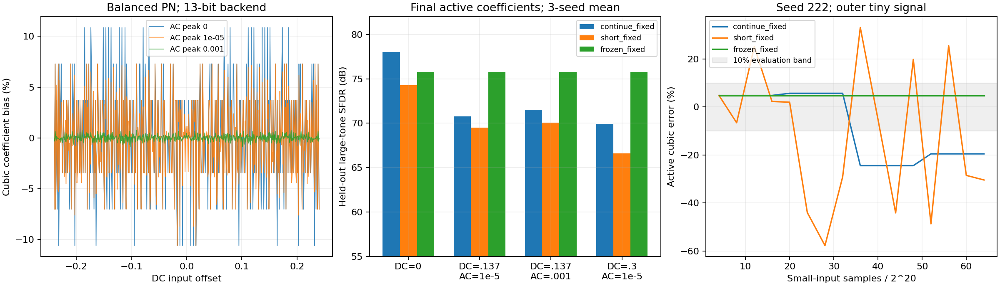

# HDC复核：低精度分母、小信号偏差和参数开放

本次修复确认的定点除零缺陷，并补充小信号验收。结论是：**算术配置错误已修复；三路PN HDC仍不能宣称在任意小信号/DC偏置下都正确收敛。** 无削顶、无定点溢出和系数更新被接受，都不是辨识正确的充分条件。

实现入口：[hdc_fixed.py](../../python/src/adctoolbox/examples/11_calibration/hdc_fixed.py)、[小信号实验](../../python/src/adctoolbox/examples/11_calibration/hdc_small_signal.py)。参数表、数学约定和硬件边界统一维护在 [HDC_FIXED.md](../../python/src/adctoolbox/examples/11_calibration/HDC_FIXED.md)。

## 1. 除零修复及参数一致性

默认峰值0.2时，每路PN幅值A=1/15。控制器将A平方、立方逐级舍入回同一小数位数：

| 小数位F | A整数码 | A²整数码 | A³整数码 |
|---|---:|---:|---:|
| 8 | 17 | 1 | 0 |
| 9 | 34 | 2 | 0 |
| 10 | 68 | 5 | 0 |
| 11 | 137 | 9 | 1 |

原先只限制F的范围，随后 `gamma3=M3/(6*A³)` 会除零。现在初始化使用控制器同样的逐级乘法/舍入检查分母；为零或饱和就抛出明确的 `ValueError`。这既拒绝默认峰值下的F=8/9/10，也覆盖较高精度配极小幅值的情况。浮点模式不受这项定点下溢限制。F=11仅说明分母非零，不意味着精度足够；默认F=24数值路径保持原样。

此前只有 `Plant(peak=...)` 暴露了物理幅值，Tracker、名义扣除和oracle仍固定为0.2。现在增加 `Tracker(dither_peak=...)` 和主实验 `--dither-peak`，并贯穿全部方法。带幅值元数据的捕获与Tracker不匹配时会报错。

主实验还开放 `--input-peak`、`--backend-bits`、`--noise-rms`；记录长度、累加窗口、种子、波形和突变/恒定场景继续通过CLI配置。定点字宽、小数位、累加器宽度和控制器延迟在Python构造器中开放。它们是运行前的配置，不是实时自动调幅功能；原资源表也不包含运行时可编程幅值的额外寄存器/模拟切换控制。

所有正式小信号实验仍使用**峰值0.2**。幅值0.15仅用于参数传递回归测试，未用增大Dither来改善实验结果。

## 2. 平衡扫描：分离不可由平均消除的量化相关偏差

[Rakuljic和Galton，TCAS-I 2013](https://doi.org/10.1109/TCSI.2012.2215754)指出，某些DC附近的小幅输入会使量化误差污染HDC相关估计。这里检查同类失效原因，未复现论文完整多级ADC，也未实现其修改相关序列和残差去相关方案。

扫描522个偏置：[-0.24,0.24]内513个均匀点，加0.137、±0.249、±0.251、±0.3、±0.6。交流峰值为0、1e−6、1e−5、1e−4、0.001、0.01、0.05。每个条件枚举八种PN状态，并用256个等间隔输入相位求积；后端分别为不量化、13位、24位，共10,962条记录。

这个诊断关闭记忆、电容失配和模拟噪声，保持G=2.04、k=−0.24，以隔离后端量化。由模型直接得到：

```
k_est − k = E[e·p1·p2·p3] / (6A³)
```

e是r坐标下的后端量化误差。全部PN状态已平衡，所以此处不是随机PN记录太短的问题。重复相同相位/PN表只会重复同一相关项，无法平均掉偏差。以下是各幅度下扫描到的最大三次系数相对偏差，不是所有连续偏置的数学上界：

| 交流峰值 | 13位后端 | 24位后端 |
|---|---:|---:|
| 0 | 10.8646% | 0.006582% |
| 1e−6 | 10.8646% | 0.000402% |
| 1e−5 | 10.5930% | 0.000852% |
| 1e−4 | 1.9597% | 0.000587% |
| 0.001 | 0.8421% | 0.000566% |
| 0.01 | 1.3450% | 0.000641% |
| 0.05 | 1.3171% | 0.000471% |

不量化时三次系数误差仅为浮点舍入量级；增益仍包含原有eta近似偏差。13位纯DC最大三次绝对偏差0.026075，对应扫描偏置−0.1846875。交流幅度增加通常有帮助，但该有限相位扫描不支持“偏差随幅度严格单调下降”的结论。

## 3. 连续联合测试：训练后继续、冻结和冷启动

正式种子111、222、333与试跑44分离。每个种子分别采用后端噪声RMS=0和0.0002，保留增益、三次非线性、线性记忆和DAC失配全部四种误差，物理参数在此次实验中保持FINAL不变。

- 先用峰值0.78的大正弦训练2²⁷点，窗口2²⁴点；额外1024点完成最后一次更新的控制器延迟。
- 对每个训练快照测试四种输入：DC=0；0.137+1e−5正弦；0.137+0.001正弦；0.3+1e−5正弦。每种继续采集2²⁶点，合计24个联合案例。
- 相同捕获同时提供给F=24/W=28长窗口、浮点长窗口、2²²点短窗口、冻结定点、名义系数冷启动定点五条路径。
- 切换时仅保留活动系数和滤波器历史，丢弃未提交估计与部分旧窗口。冻结路径不再更新；没有把物理真值装入学习器。
- 用最终活动系数，在独立PN种子、另一频率、峰值0.65的大正弦上冻结评估。全部保留最终点，没有选取历史最佳频谱。最后一窗尚未提交的shadow估计也存入JSON。

所有小信号案例零过载，最小模拟余量0.16024；采样数据通路、累加器和控制器均无饱和。但在默认噪声条件下，长窗口最终三次系数误差在内侧微小信号案例最高13.23%、外侧微小信号最高19.65%；短窗口分别最高20.21%、30.53%。这些条件未通过10%系数误差带。

浮点与F=24定点的最终三次系数最大差异仅1.53e−5，约真实系数的0.0064%，远小于上述误差。不同种子的误差差异很大，且有/无默认模拟噪声的结果相近，说明有限记录相关误差仍显著；不能把这些流式误差全部归为量化偏置。平衡扫描则独立确认了无法靠增加窗口消除的量化项。

以下为后续独立大信号的三种子平均SNDR/SFDR，后端采用默认噪声0.0002：

| 小信号学习条件 | 继续更新，2²⁴窗 | 继续更新，2²²窗 | 冻结大信号训练系数 |
|---|---:|---:|---:|
| DC=0 | 60.98 / 77.57 | 60.32 / 74.30 | 60.19 / 75.77 |
| DC=0.137，AC=1e−5 | 60.00 / 71.45 | 59.21 / 70.00 | 60.19 / 75.77 |
| DC=0.137，AC=0.001 | 60.00 / 71.44 | 59.23 / 70.03 | 60.19 / 75.77 |
| DC=0.3，AC=1e−5 | 59.39 / 69.75 | 55.74 / 66.70 | 60.19 / 75.77 |

冻结在部分偏置下保住了更好的SFDR，但DC=0时继续学习更好，不能把冻结写成普遍优胜方案。大信号训练本身也有有限样本误差，三种子的初始三次误差约−8.5%、+4.8%、+3.4%，不是理想系数。

冷启动在三个内侧条件下后续大信号SNDR仅约38.93 dB：这些输入的粗码一直为零，DAC失配没有激励，系数保持初值。该结果不能误解成只有三次非线性估计失败。外侧条件有粗码占用，可以学习该失配模式。

纯DC仅报告平均误差、RMS和去均值误差；小交流信号保留其自身SNDR/SFDR，但它可能低于噪声底。上表始终是独立大信号测试。冻结后的温漂/参数突变没有在本批复验，不能据此批准长期冻结策略。

## 4. 复现、验证和结论边界

```powershell
cd python
uv run --no-sync --with numba python src/adctoolbox/examples/11_calibration/hdc_small_signal.py --output ../agent_playground/hdc-small-new
```

正式运行将三个种子分成独立进程，参数与上述默认命令相同，每个进程8例、约248–251秒。配置和所有数值源文件SHA-256均保存在[审计JSON](hdc-small-audit-20261102.json)，运行前后哈希一致。旧实验审计文件未改写；旧代码基线可在`8901c09`查看，新修复和新数据使用本次源文件。

- [平衡偏置/幅度扫描](hdc-small-balanced-20261102.csv)
- [全部活动参数轨迹](hdc-small-trajectories-20261102.csv)
- [逐种子小信号及独立大信号结果](hdc-small-spectra-20261102.csv)
- [三种子汇总](hdc-small-summary-20261102.csv)

针对HDC、架构示例及新控制的回归为43项通过；关闭JIT的分母/幅值专项为14项通过。文档使用Sphinx `-W`构建。新增测试覆盖初始化拒绝、最小有效格式、极小幅值下溢、幅值一致传递、冻结时未提交估计处理、量化偏差恒等式和DC指标标签。

wheel与源码包构建成功。独立环境安装wheel、复制示例后，在未安装Numba的情况下通过低精度拒绝、幅值0.15的转换/跟踪及小信号平衡控制，并检查两个CLI入口。wheel中的五个正式实验源文件与运行审计哈希一致，且不含生成的缓存或输出目录；这项安装检查不替代上面的长记录实验。

**验收范围：除零缺陷关闭，幅值配置路径打通，小信号失效证据补全；任意偏置上的后台收敛仍未通过通用验收。** 增大窗口可减少有限记录波动，不能替代量化去相关机制。2013方案、自动小信号更新门控及冻结后漂移跟踪仍需分别实现和验证。


