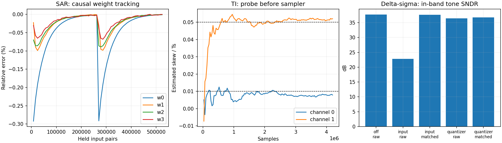

# 三路 PN：不同 ADC 的注入位置与辨识机制

本批把 Dither 文档统一到 [DITHER_GUIDE.md](../../python/src/adctoolbox/examples/11_calibration/DITHER_GUIDE.md)，再用同一种离散激励检查不同结构中的可观察性与失败条件。这里“完整整理”指已有机制、数学前提、实验和缺口均有明确入口，不表示已经完成所有 ADC 电路或全部误差的通用校准。

## 统一条件

所有开启的激励均为 `d=(p1+p2+p3)/15`，三路独立状态的 31/29/23 位 LFSR，峰值 **0.2**，四电平理想概率 1:3:3:1。Pipeline、SAR、TI、Delta-sigma 的节点归一化不同，因此不能用各表绝对 SNDR 给架构排名。TI 使用这些离散值作为线性斜坡端点，中间时刻允许连续电平，峰值仍不超过 0.2。

正式运行使用未用于试跑的种子 **707、808、909**。试跑种子 44 仅检查程序/图表。产物包含四种 Pipeline 解析对照、12 个 SAR 训练案例、18 个 TI 案例和63条 Delta-sigma 输出处理记录。SAR/TI 每个案例都使用独立频率、冻结参数、关闭探针的后续记录评估；未选择历史最好频谱。

代码：[exp_cal09_pn_architectures.py](../../python/src/adctoolbox/examples/11_calibration/exp_cal09_pn_architectures.py) 和 [pn_architectures.py](../../python/src/adctoolbox/examples/11_calibration/pn_architectures.py)。它们是浮点行为模型。定点、乘法器和寄存器预算仍以 [HDC_FIXED.md](../../python/src/adctoolbox/examples/11_calibration/HDC_FIXED.md) 的单级架构为准，不能把其资源数套到本批所有 ADC。

## Pipeline：位置错误时，增加样本无济于事

采用 `F(v)=1.02v−0.24v³`，残差输入为峰值0.25的正弦；对当前/前一拍PN及输入相位完全枚举。该枚举消除了有限样本方差，用来验证期望公式，不是硬件后台采集流程。

| 条件 | 三阶相关估计 | 真实三次系数 | 校正后输入重建 RMS 误差 |
|---|---:|---:|---:|
| PN在放大器前 | −0.240000 | −0.24 | 0.000617 |
| PN在放大器后 | 约0 | −0.24 | 0.001683 |
| 前置PN，另有 `0.2v⁵` | −0.168611 | −0.24 | 0.000564 |
| 前置PN，另有 `0.3v·v_previous²` | −0.240000 | −0.24 | 0.003236 |

后置探针没有经历待测非线性，三阶相关为零。五次项会进入三阶统计，即 `k_est=k+k5*(10E[u²]+10A²)`，因此曲线变好不能证明物理系数辨识正确。非线性记忆案例则说明：三次系数可以估对，但整体静态逆仍不足以校正动态误差。

这里的RMS误差不是频谱SNDR。连续流、四误差联合、长窗口和定点结果继续使用已有 [HDC报告](2026-11-02-hdc-fixed.md)，无需把旧模型重命名为本批的新模型。

## SAR：辨识对象是位权，必须保留可用的观测

使用14次有符号判决、radix=1.85的冗余SAR。**这不等于14位二进制SAR。** 四个高权重未知，低十个权重作为已知锚点；没有同时估计全部电容、参考增益和比较器误差。权重是等效转换电压，模型不是独立电容Monte Carlo或完整开关电荷仿真。

同一个保持样本分别注入 `+d`、`−d`，得到两组原始判决位。校准误差为 `2d−Σ(b+−b−)w_hat`；用有界归一化LMS更新四个位权，当前输出先使用旧权重，再更新。无需输入真值，位差乘法可用符号/零选择，分母只有少量离散值。

每例 **2^19 个保持样本、2^20 次转换**，在中点改变四个位权；步长固定为2^-10。有效案例最小模拟余量0.10116，未出现rail，更新没有被权重边界拒绝。两个转换若来自不同输入样本，则差分不再消掉未知输入：失败对照保留这一错误，训练权重走向边界。

以下是三个种子均值，冻结参数后在新频率、不加Dither的记录上评估：

| 方法 | 单音SNDR / SFDR (dB) | 双音目标功率比 / 杂散比 (dB) |
|---|---:|---:|
| 名义位权 | 44.18 / 46.19 | 40.41 / 44.24 |
| 正确同样本双转换辨识 | **75.28 / 104.55** | **72.39 / 100.83** |
| 真实位权，仅评估 | 75.29 / 104.55 | 72.40 / 100.82 |
| 两次转换输入不同的失败对照 | 39.40 / 42.89 | 36.33 / 42.94 |
| 真输入拟合的最佳线性＋三次诊断对照 | 46.50 / 50.56 | 43.45 / 49.83 |

有效案例四个位权的相对RMSE为 **0.000685%–0.001665%**。这依赖已知低位权、已知注入尺度、冗余和同样本保持等理想条件，不能外推到任意SAR。

另外运行了直接套用HDC三阶相关的失败路径：单音估计触发系数边界而保持名义输出；双音结果平均降至31.41 dB目标功率比。由于有限样本也影响该估计，另加了上表“真输入拟合”的全局三次诊断对照：即使给予理想拟合信息，全局三次函数仍不能替代此处的码相关位权修正。这个最小二乘对照只用于评估，**不参与硬件候选的SAR学习器**。

该方法借用 [Chiu等，SampTA 2013](https://www.eurasip.org/Proceedings/Ext/SampTA2013/papers/p544-chiu.pdf) 的ODC观测关系，并把其偏移激励改为本批三路PN构造。它需要两个转换周期/输出；不能包装成无吞吐量代价的单转换后台算法。无冗余结构产生的模拟判决空隙也不能仅靠数字位权恢复。

## TI：同样的PN电平，有斜率才有时序信息

两个通道真实增益为1、1.02，真实采样偏差为0.01Ts、0.05Ts。前置线性斜坡模型满足：

```
d(n+tau)=(1−tau)d[n]+tau*d[n+1]
m0=E[y*d[n]]/Var(d), m1=E[y*d[n+1]]/Var(d)
g_hat=m0+m1, tau_hat=m1/g_hat
```

每例2^22个总采样，累计相关；没有输入真值或输入斜率进入估计器。后续独立记录使用估计增益和分辨率1/4096Ts的理想时钟修调执行器。理想探针时基、斜坡、通道一致性和修调器均为模型假设，不是已验证的电路。

| 注入条件 | 单音SNDR / SFDR (dB) | 双音目标功率比 / 杂散比 (dB) |
|---|---:|---:|
| 不校准 | 32.19 / 32.19 | 34.43 / 34.13 |
| 采样前，有已知线性斜率 | **49.46 / 49.49** | **54.61 / 54.46** |
| 采样前，采样附近为平坦电平 | 33.18 / 33.18 | 35.66 / 34.68 |
| 采样和通道增益之后 | 32.14 / 32.14 | 34.18 / 33.97 |
| 真增益/真时序修调，仅评估 | 72.23 / 104.11 | 69.30 / 99.31 |

前置有斜率案例的通道相对偏差估计误差绝对值仍有0.00122–0.00591Ts，尚未达到噪声极限；这是可观察性和有限记录精度的证据，不是完整TI校准验收。所有正常TI案例均无过载，最小模拟余量约0.08158。

PN序列的构造无法自行定义模拟时间斜率。四电平值在采样附近若保持不变，输出对时移的一阶变化为零，累加再久也不能从这条探针路径测出时差。后置控制还绕过了通道增益，因此也无法用它测量上游增益。

## Delta-sigma：去掉已知探针项不等于消除量化噪声

使用一阶、1位量化器环路，OSR=32，丢弃8192点启动段后分析2^18点；0 dBFS定义为峰值1正弦的功率。反馈使用原始量化器输出，数字扣除仅在输出后处理。

- 输入求和节点注入：`y=x+d+(1−z^-1)e`。
- 量化器输入注入：`y=x+(1−z^-1)d+(1−z^-1)e`。

代码中这两个代数恒等式的最大数值误差为 **4.44e−16**，最大内部状态约1.2。它们不要求量化误差为白噪声；实际量化误差是否被随机化，要另看频谱。

单音、量化器前注入时：错误地直接减 `d[n]`，带内SNDR为 **22.76 dB**；按正确路径减 `d[n]−d[n−1]` 后为 **36.87 dB**。无Dither参考约37.73 dB，所以这个例子不能宣称Dither提高了积分SNDR。

DC=1/64时，未加Dither的最大带内闲置音为−30.10 dBFS。输入节点注入并正确扣除后，三种子平均最大杂散为−64.31 dBFS；但量化器前注入并正确扣除，仅到−32.46 dBFS，仍有明显音调。另一个DC条件下，加Dither甚至明显增加积分带内噪声。

因此，**相同的四电平PN不保证所有输入、所有注入位置都去除闲置音**。本批离散PN结果不应引用连续随机Dither的理论作为无条件保证。DC记录只报告带内噪声、杂散和偏置，不给没有意义的DC“SNDR”。

## 重现、产物和发布边界

```powershell
cd python
uv run --no-sync --with numba python src/adctoolbox/examples/11_calibration/exp_cal09_pn_architectures.py --output ../agent_playground/pn-architectures-new
```

原始记录在 `agent_playground/pn-architectures-main-20261102`；该目录非Git产物。可审查的配置/源文件SHA-256和完整汇总在 [审计JSON](pn-architectures-audit-20261102.json)。

- [独立测试频谱](pn-architectures-spectra-20261102.csv)
- [参数/余量/拒绝更新](pn-architectures-parameters-20261102.csv)
- [Pipeline解析边界](pn-architectures-pipeline-20261102.csv)
- [Delta-sigma全部记录](pn-architectures-delta-sigma-20261102.csv)
- [PN分布检查](pn-architectures-distribution-20261102.csv)

新机制测试12项通过，覆盖PN跨块状态、SAR因果更新与同样本要求、二进制空隙信息损失、TI探针可观察性、Delta-sigma精确传递关系、频谱标签及不可覆盖输出目录。本次独立 Dither PR 的回归、文档和发行包验证在[独立 PR 验证记录](2026-11-02-dither-pr.md)中汇总；该记录与此前包含其他校准功能的整包发布验收分开。

不新增公共校准API，不修改既有实验的PN分布和历史结论。Flash阈值逐项校准、完整Pipeline-SAR、任意多位SAR权重、一般非线性记忆、多阶Delta-sigma和真实TI执行器仍是明确缺口。它们在总览中有位置，不被列为已实现能力。


